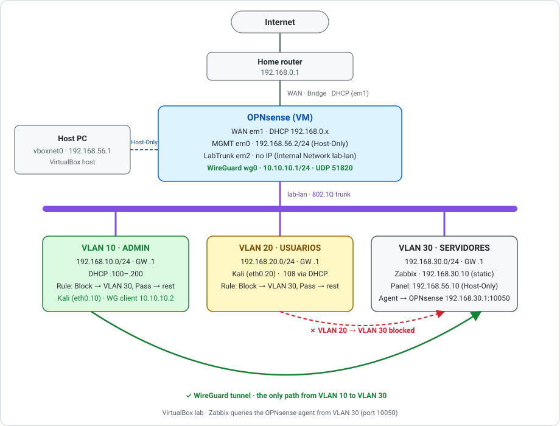

# Lab: VLANs, Firewall OPNsense e Monitoramento com Zabbix

🇧🇷 [Português](#-português) · 🇺🇸 [English](#-english)

---

## 🇧🇷 Português

### Objetivo
Montar uma rede segmentada em VLANs, controlada por um firewall OPNsense e monitorada com Zabbix, documentando cada etapa para que qualquer pessoa consiga reproduzir o lab.

### O que este projeto demonstra
- Segmentação de rede com VLANs (802.1Q) e roteamento entre VLANs
- Regras de firewall por segmento (princípio do menor privilégio)
- DHCP e DNS por VLAN
- Monitoramento de hosts e serviços com Zabbix (itens, triggers e alertas)
- Troubleshooting e validação documentados

### Ambiente
| Item | Valor |
|---|---|
| Virtualização | VirtualBox `[versão]` |
| Firewall | OPNsense 26.7.7 |
| Monitoramento | Zabbix 6.4.21 (Docker Compose) |
| Clientes de teste | `[ex.: Windows Server, Linux, PC cliente]` |

### Topologia

### Plano de endereçamento (sugestão, ajuste ao seu lab)
| VLAN | Nome | Rede | Gateway | DHCP |
|---|---|---|---|---|
| 10 | Administração | 192.168.10.0/24 | .1 | Sim |
| 20 | Usuários | 192.168.20.0/24 | .1 | Sim |
| 30 | Servidores | 192.168.30.0/24 | .1 | Não (IP fixo) |

### Passo a passo
1. **Preparar o ambiente virtual** e as interfaces de rede das VMs
2. **Instalar o OPNsense** e configurar WAN/LAN
3. **Criar as VLANs** no OPNsense (Interfaces → Devices → VLAN) e atribuir interfaces
4. **Configurar DHCP** por VLAN
5. **Criar regras de firewall** entre VLANs
6. **Instalar o Zabbix Server** (VM na VLAN 30)
7. **Instalar o Zabbix Agent** nos hosts e cadastrá-los
8. **Criar triggers e alertas** (host fora do ar, uso de CPU, disco)
9. **Validar** (ping, traceroute, testes de bloqueio e de alerta)

> Cada passo terá sua página em `docs/` com comandos, prints e observações.

### Validação
| Teste | Resultado esperado | Resultado obtido |
|---|---|---|
| Cliente na VLAN 20 recebe IP por DHCP | IP `192.168.20.x` | Recebeu `192.168.20.108/24` |
| Ping VLAN 20 → gateway (`192.168.20.1`) | Sucesso | Sucesso: 3/3 respostas, 0% de perda (~1,4 ms) |
| Ping VLAN 20 → internet (`8.8.8.8`) | Sucesso (via NAT) | Sucesso: 3/3 respostas, 0% de perda (~38 ms) |
| Ping VLAN 20 → VLAN 30 | Bloqueado | Bloqueado: 100% de perda (testado em `192.168.30.1` e `192.168.30.10`) |
| Zabbix monitora o OPNsense (agente em `192.168.30.1:10050`) | Disponibilidade ZBX verde | ZBX verde, 108 itens coletados |
| Zabbix detecta host desligado | Alerta em até 3 min | **Alertou em cerca de 2 min** (Kali desligado às 15:17; problema `High` às 15:19:21). Ver [passo 7](docs/07-gatilho-host-fora-do-ar.md) |

Evidências com prints em [`docs/04-dhcp-firewall.md`](docs/04-dhcp-firewall.md) e [`docs/05-zabbix-vlan30.md`](docs/05-zabbix-vlan30.md).

### Problemas encontrados e soluções
| Sintoma | Causa | Solução |
|---|---|---|
| LAN e WAN do OPNsense ambas em `192.168.0.0/24` | Os dois adaptadores estavam em Bridge, então LAN e WAN ficaram na rede doméstica, sem isolamento | Adaptador 1 em Host-Only (gerência), adaptador 2 em Bridge (WAN) e adaptador 3 em Rede Interna `lab-lan` (VLANs) |
| VirtualBox: "Configurações inválidas detectadas" e botão OK desabilitado | Adaptador Host-Only sem a rede selecionada no campo **Nome** | Criar e selecionar a rede `vboxnet0` no Gerenciador de Rede |
| IP `192.168.0.50` inacessível depois de trocar para Host-Only | A Host-Only é outra sub-rede (`192.168.56.0/24`) | Trocar o IP da interface de gerência para `192.168.56.2/24` pelo console |
| Erro ao salvar a VLAN com o dispositivo `VLAN10` | O nome do dispositivo precisa começar com `vlan` em minúsculo | Usar `vlan10`; o sistema normalizou para `vlan010` |
| Duas conexões de VLAN no Kali (`vlan020` e `vlan20`) para a mesma `eth0.20` | O `nmcli connection add` foi executado duas vezes com nomes diferentes | Remover a duplicada com `nmcli connection delete` |
| `modprobe: Module 8201q not found` no Debian | Erro de digitação: o módulo é `8021q` | Repetir o comando com o nome correto |
| `/etc/resolv.conf` com o texto `nameserver 1.1.1.1/nnameserver 8.8.8.8/n` | No `printf` foi usada a barra normal (`/n`) em vez da invertida (`\n`) | Regravar com `\n` e conferir com `cat` |
| Host do OPNsense com ZBX vermelho no Zabbix | O host foi criado com a interface padrão `127.0.0.1` (dentro do container, o próprio servidor) e, depois, o IP foi digitado no campo **DNS name** | Colocar `192.168.30.1` no campo **IP address** e deixar **DNS name** vazio |

Os detalhes de cada passo estão nas páginas de [`docs/`](docs/).

### Aprendizados
- Separar gerência (Host-Only), WAN (Bridge) e rede do lab (Rede Interna) evita sub-redes sobrepostas. Duas interfaces na mesma sub-rede deixam o roteamento ambíguo e anulam o isolamento.
- O VirtualBox não tem switch gerenciável: a marcação 802.1Q foi feita dentro da VM cliente (subinterface `eth0.20`), com a Rede Interna em modo promíscuo **Permitir Tudo**.
- Em firewall, a ordem das regras importa: o **Block** para a VLAN 30 precisa vir antes do **Pass** geral da VLAN 20. Interfaces novas bloqueiam tudo até que existam regras.
- Testar o que deve falhar é tão importante quanto testar o que deve funcionar: o ping bloqueado da VLAN 20 para a VLAN 30 é a prova da segmentação.
- No Zabbix em Docker, `127.0.0.1` no cadastro do host aponta para o próprio container. O agente vê como origem o IP do host Docker (`192.168.30.10`), e é esse IP que vai na lista de servidores permitidos.
- Erros pequenos de digitação (`8201q`, `/n`) são comuns; conferir a saída dos comandos (`cat`, `ip -br addr`, `ping`) antes de seguir evita perder tempo mais adiante.
- Documentar os erros reais, com sintoma, causa e solução, torna o lab reproduzível e mostra o raciocínio de troubleshooting.

### Autor
Deyvison Ferreira da Silva · Recife, PE · [LinkedIn](https://www.linkedin.com/in/deyvisonfsilva/)

---

## 🇺🇸 English

### Goal
Build a VLAN-segmented network controlled by an OPNsense firewall and monitored with Zabbix, documenting every step so anyone can reproduce the lab.

### What this project demonstrates
- Network segmentation with VLANs (802.1Q) and inter-VLAN routing
- Per-segment firewall rules (least privilege)
- DHCP and DNS per VLAN
- Host and service monitoring with Zabbix (items, triggers, alerts)
- Documented troubleshooting and validation

### Environment
| Item | Value |
|---|---|
| Virtualization | VirtualBox `[version]` |
| Firewall | OPNsense 26.7.7 |
| Monitoring | Zabbix 6.4.21 (Docker Compose) |
| Test clients | `[e.g., Windows Server, Linux, client PC]` |

### Topology

### Addressing plan (suggested, adjust to your lab)
| VLAN | Name | Network | Gateway | DHCP |
|---|---|---|---|---|
| 10 | Administration | 192.168.10.0/24 | .1 | Yes |
| 20 | Users | 192.168.20.0/24 | .1 | Yes |
| 30 | Servers | 192.168.30.0/24 | .1 | No (static) |

### Step by step
1. **Prepare the virtual environment** and VM network interfaces
2. **Install OPNsense** and configure WAN/LAN
3. **Create VLANs** in OPNsense (Interfaces → Devices → VLAN) and assign interfaces
4. **Configure DHCP** per VLAN
5. **Create firewall rules** between VLANs
6. **Install Zabbix Server** (VM on VLAN 30)
7. **Install Zabbix Agent** on hosts and register them
8. **Create triggers and alerts** (host down, CPU, disk usage)
9. **Validate** (ping, traceroute, block and alert tests)

> Each step will have its own page under `docs/` with commands, screenshots and notes.

### Validation
| Test | Expected | Actual |
|---|---|---|
| Client on VLAN 20 gets an IP via DHCP | `192.168.20.x` address | Got `192.168.20.108/24` |
| Ping VLAN 20 → gateway (`192.168.20.1`) | Success | Success: 3/3 replies, 0% loss (~1.4 ms) |
| Ping VLAN 20 → internet (`8.8.8.8`) | Success (via NAT) | Success: 3/3 replies, 0% loss (~38 ms) |
| Ping VLAN 20 → VLAN 30 | Blocked | Blocked: 100% loss (tested against `192.168.30.1` and `192.168.30.10`) |
| Zabbix monitors OPNsense (agent at `192.168.30.1:10050`) | Green ZBX availability | Green ZBX, 108 items collected |
| Zabbix detects powered-off host | Alert within 3 min | **Alerted in about 2 min** (Kali powered off at 15:17; `High` problem at 15:19:21). See [step 7](docs/07-gatilho-host-fora-do-ar.md) |

Evidence with screenshots in [`docs/04-dhcp-firewall.md`](docs/04-dhcp-firewall.md) and [`docs/05-zabbix-vlan30.md`](docs/05-zabbix-vlan30.md).

### Issues found and fixes
| Symptom | Cause | Fix |
|---|---|---|
| OPNsense LAN and WAN both on `192.168.0.0/24` | Both adapters were on Bridge, so LAN and WAN sat on the home network, with no isolation | Adapter 1 on Host-Only (management), adapter 2 on Bridge (WAN) and adapter 3 on Internal Network `lab-lan` (VLANs) |
| VirtualBox: "Invalid settings detected" and OK button disabled | Host-Only adapter with no network selected in the **Name** field | Create and select the `vboxnet0` network in Network Manager |
| IP `192.168.0.50` unreachable after switching to Host-Only | Host-Only is a different subnet (`192.168.56.0/24`) | Change the management interface IP to `192.168.56.2/24` from the console |
| Error when saving the VLAN with device `VLAN10` | The device name must start with a lowercase `vlan` | Use `vlan10`; the system normalized it to `vlan010` |
| Two VLAN connections on Kali (`vlan020` and `vlan20`) for the same `eth0.20` | `nmcli connection add` was run twice with different names | Remove the duplicate with `nmcli connection delete` |
| `modprobe: Module 8201q not found` on Debian | Typo: the module is `8021q` | Re-run the command with the correct name |
| `/etc/resolv.conf` containing the text `nameserver 1.1.1.1/nnameserver 8.8.8.8/n` | `printf` was typed with a forward slash (`/n`) instead of a backslash (`\n`) | Rewrite it with `\n` and check with `cat` |
| OPNsense host with red ZBX in Zabbix | The host was created with the default interface `127.0.0.1` (inside the container, the server itself) and, later, the IP was typed in the **DNS name** field | Put `192.168.30.1` in **IP address** and leave **DNS name** empty |

Details of each step are in the [`docs/`](docs/) pages.

### Lessons learned
- Separating management (Host-Only), WAN (Bridge) and the lab network (Internal Network) avoids overlapping subnets. Two interfaces on the same subnet make routing ambiguous and defeat isolation.
- VirtualBox has no managed switch: 802.1Q tagging was done inside the client VM (`eth0.20` subinterface), with the Internal Network in promiscuous mode **Allow All**.
- Firewall rule order matters: the **Block** to VLAN 30 must come before VLAN 20's general **Pass**. New interfaces block everything until rules exist.
- Testing what must fail is as important as testing what must work: the blocked ping from VLAN 20 to VLAN 30 is the proof of segmentation.
- With Zabbix in Docker, `127.0.0.1` in the host entry points to the container itself. The agent sees the Docker host's IP (`192.168.30.10`) as the source, and that is the IP that goes in the allowed servers list.
- Small typing mistakes (`8201q`, `/n`) are common; checking command output (`cat`, `ip -br addr`, `ping`) before moving on saves time later.
- Documenting real errors, with symptom, cause and fix, makes the lab reproducible and shows troubleshooting reasoning.

### Author
Deyvison Ferreira da Silva · Recife, Brazil · [LinkedIn](https://www.linkedin.com/in/deyvisonfsilva/)
