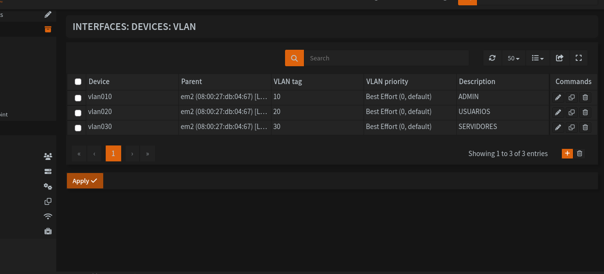
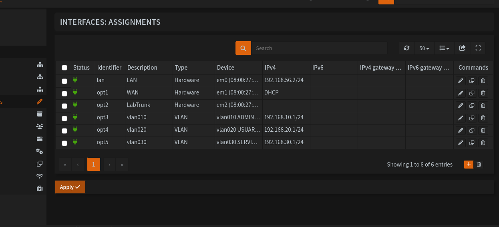
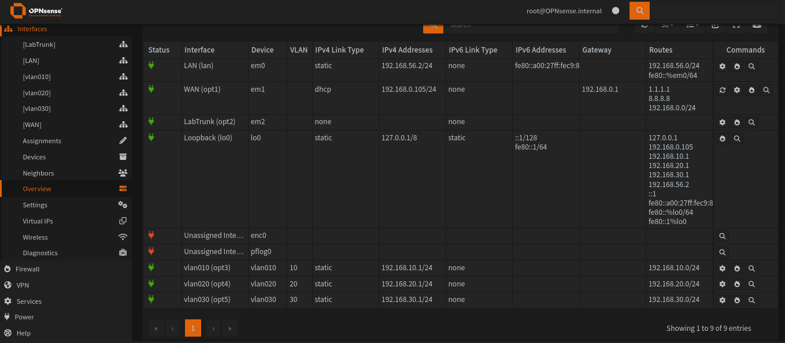

# 03 · VLANs

[← README](../README.md) · [← 02 OPNsense](02-opnsense.md) · [04 DHCP e firewall →](04-dhcp-firewall.md)

## 🇧🇷 Português

### Objetivo
Criar as VLANs 10, 20 e 30 sobre a placa `em2` (tronco `lab-lan`) e atribuir a cada uma o IP do gateway no OPNsense.

### Plano
| VLAN | Dispositivo | Descrição | IP do OPNsense (gateway) | Uso |
|---|---|---|---|---|
| 10 | `vlan010` | ADMIN | `192.168.10.1/24` | Administração |
| 20 | `vlan020` | USUARIOS | `192.168.20.1/24` | Usuários |
| 30 | `vlan030` | SERVIDORES | `192.168.30.1/24` | Servidores (Zabbix) |

### Passo a passo
1. **Criar as VLANs:** Interfaces → Devices → VLAN → **+**. Parent `em2`, VLAN tag (10, 20 ou 30), prioridade *Best Effort (0, default)*, descrição conforme a tabela. O nome do dispositivo precisa começar com `vlan` em minúsculo.
2. **Atribuir como interfaces:** Interfaces → Assignments → **+**, escolher cada dispositivo (`vlan010`, `vlan020`, `vlan030`) e salvar. Elas aparecem como `opt3`, `opt4` e `opt5`. Clicar em **Apply**.
3. **Habilitar e dar IP:** em cada interface nova, marcar **Enable**, IPv4 **Static IPv4**, informar o IP da tabela com máscara `/24`, IPv6 **None** e sem gateway. Salvar e **Apply changes**.
4. **Conferir:** Interfaces → Overview.

> Neste ponto ainda não há DHCP nem regras de firewall. Interfaces novas bloqueiam todo o tráfego até que as regras sejam criadas (próximo passo).

### Validação
| Teste | Resultado esperado | Resultado obtido |
|---|---|---|
| Três VLANs listadas com tag 10, 20 e 30 e parent `em2` | Sim | Sim (Interfaces → Devices → VLAN) |
| Interfaces `opt3`, `opt4` e `opt5` ativas, com os IPs do plano | Sim | Sim, com status ativo (Interfaces → Overview) |
| Rotas `192.168.10.0/24`, `192.168.20.0/24` e `192.168.30.0/24` criadas | Sim | Sim |

**Evidências**

*VLANs 10, 20 e 30 criadas sobre a `em2`.*

*Interfaces atribuídas: LAN, WAN, LabTrunk e as três VLANs, com os IPs do plano.*

*Interfaces → Overview: as três VLANs ativas e as rotas `192.168.10.0/24`, `192.168.20.0/24` e `192.168.30.0/24`.*

### Problemas encontrados e soluções
| Sintoma | Causa | Solução |
|---|---|---|
| Erro "The device name prefix "vlan" is required" ao salvar a VLAN com o dispositivo `VLAN10` | O nome do dispositivo precisa começar com `vlan` em minúsculo | Usar `vlan10`, `vlan20` e `vlan30`; o sistema normalizou para `vlan010`, `vlan020` e `vlan030` |

### Próximo passo
[04 · DHCP, firewall e testes](04-dhcp-firewall.md)

---

## 🇺🇸 English

### Goal
Create VLANs 10, 20 and 30 on the `em2` NIC (the `lab-lan` trunk) and assign each one its gateway IP on OPNsense.

### Plan
| VLAN | Device | Description | OPNsense IP (gateway) | Use |
|---|---|---|---|---|
| 10 | `vlan010` | ADMIN | `192.168.10.1/24` | Administration |
| 20 | `vlan020` | USUARIOS | `192.168.20.1/24` | Users |
| 30 | `vlan030` | SERVIDORES | `192.168.30.1/24` | Servers (Zabbix) |

### Step by step
1. **Create the VLANs:** Interfaces → Devices → VLAN → **+**. Parent `em2`, VLAN tag (10, 20 or 30), priority *Best Effort (0, default)*, description from the table. The device name must start with a lowercase `vlan`.
2. **Assign as interfaces:** Interfaces → Assignments → **+**, pick each device (`vlan010`, `vlan020`, `vlan030`) and save. They show up as `opt3`, `opt4` and `opt5`. Click **Apply**.
3. **Enable and set IP:** on each new interface, tick **Enable**, IPv4 **Static IPv4**, enter the table's IP with a `/24` mask, IPv6 **None** and no gateway. Save and **Apply changes**.
4. **Check:** Interfaces → Overview.

> At this point there is no DHCP and no firewall rules yet. New interfaces block all traffic until rules are created (next step).

### Validation
| Test | Expected | Actual |
|---|---|---|
| Three VLANs listed with tags 10, 20 and 30 and parent `em2` | Yes | Yes (Interfaces → Devices → VLAN) |
| Interfaces `opt3`, `opt4` and `opt5` up, with the planned IPs | Yes | Yes, status up (Interfaces → Overview) |
| Routes `192.168.10.0/24`, `192.168.20.0/24` and `192.168.30.0/24` created | Yes | Yes |

**Evidence**

*VLANs 10, 20 and 30 created on `em2`.*

*Assigned interfaces: LAN, WAN, LabTrunk and the three VLANs, with the planned IPs.*

*Interfaces → Overview: the three VLANs up and the routes `192.168.10.0/24`, `192.168.20.0/24` and `192.168.30.0/24`.*

### Issues found and fixes
| Symptom | Cause | Fix |
|---|---|---|
| Error "The device name prefix "vlan" is required" when saving the VLAN with device `VLAN10` | The device name must start with a lowercase `vlan` | Use `vlan10`, `vlan20` and `vlan30`; the system normalized them to `vlan010`, `vlan020` and `vlan030` |

### Next step
[04 · DHCP, firewall and tests](04-dhcp-firewall.md)
