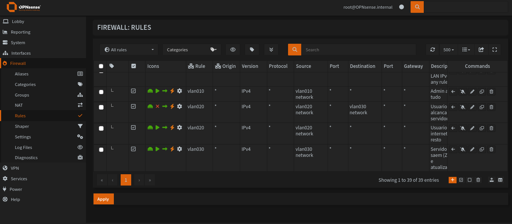
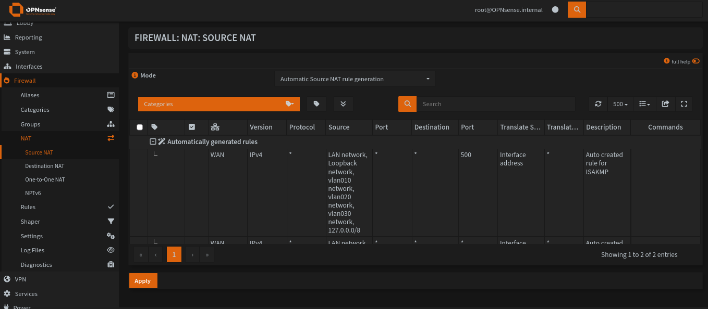
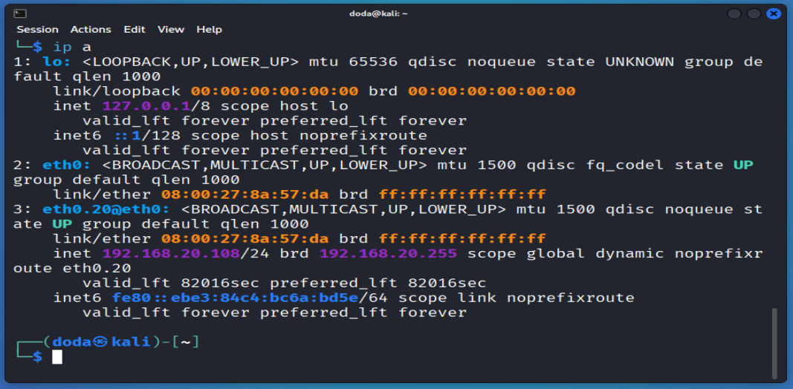
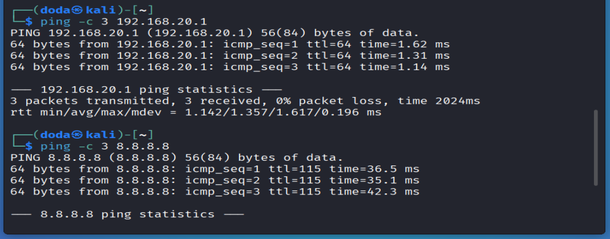
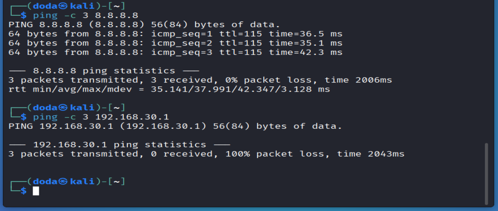

# 04 · DHCP, Firewall e Testes / DHCP, Firewall and Tests

[← README](../README.md) · [← 03 VLANs](03-vlans.md)

## 🇧🇷 Português

### Objetivo
Entregar IP automático para as VLANs 10 e 20, criar regras de firewall por VLAN e provar com um cliente real (Kali Linux na VLAN 20) que o acesso é permitido onde deve e bloqueado onde deve.

### 1. DHCP (Dnsmasq)
Caminho: **Services → Dnsmasq DNS & DHCP → DHCP ranges → +**

| Interface | Início | Fim | Lease |
|---|---|---|---|
| `vlan010` (ADMIN) | `192.168.10.100` | `192.168.10.200` | 86400 s (padrão) |
| `vlan020` (USUARIOS) | `192.168.20.100` | `192.168.20.200` | 86400 s (padrão) |

A VLAN 30 (SERVIDORES) não tem faixa: o Zabbix usará IP fixo (`192.168.30.10`).

### 2. Regras de firewall
Caminho: **Firewall → Rules**, aba de cada interface. O OPNsense avalia de cima para baixo e para na primeira regra que corresponde, por isso o **Block** vem antes do **Pass** na VLAN 20.

| Interface | Ordem | Ação | Origem | Destino | Descrição |
|---|---|---|---|---|---|
| ADMIN | 1 | Pass | `vlan010 network` | any | Admin acessa tudo |
| USUARIOS | 1 | **Block** | `vlan020 network` | `vlan030 network` | Usuarios nao alcancam servidores |
| USUARIOS | 2 | Pass | `vlan020 network` | any | Usuarios: internet e resto |
| SERVIDORES | 1 | Pass | `vlan030 network` | any | Servidores saem (Zabbix e atualizacoes) |

Todas: direção `in`, IPv4, protocolo `any`. Depois de criar, **Apply**.

> A regra de SERVIDORES é ampla de propósito, para o Zabbix funcionar e baixar atualizações. Fica como ponto de melhoria (restringir ao necessário).

### 3. NAT de saída
Caminho: **Firewall → NAT → Source NAT**. Modo **Automatic Source NAT rule generation**; as regras automáticas pela WAN já incluem as redes `vlan010`, `vlan020` e `vlan030`. Nada precisou ser alterado.

### 4. Cliente de teste (Kali Linux na VLAN 20)
**VirtualBox (VM desligada):** Adaptador 1 em **Rede Interna** `lab-lan`, Intel PRO/1000 MT Desktop, Modo Promíscuo **Permitir Tudo**, cabo conectado.

**No Kali (a placa se chama `eth0`):**
```bash
sudo modprobe 8021q
ip -br link
sudo nmcli connection add type vlan con-name vlan20 ifname eth0.20 dev eth0 id 20
sudo nmcli connection up vlan20
ip -4 addr show eth0.20
```

### 5. Validação
| Teste | Esperado | Resultado obtido |
|---|---|---|
| Cliente recebe IP `192.168.20.x` na `eth0.20` | Sim | **Recebeu** `192.168.20.108/24` por DHCP (`dynamic`, lease de ~24 h) |
| `ping -c 3 192.168.20.1` (gateway da VLAN 20) | Responde | **Respondeu** (3/3, 0% de perda, ~1,4 ms) |
| `ping -c 3 8.8.8.8` (internet, via NAT) | Responde | **Respondeu** (3/3, 0% de perda, ~38 ms) |
| `ping -c 3 192.168.30.1` (VLAN 30, bloqueada) | Sem resposta | **Sem resposta** (100% de perda) |

Conclusão: o DHCP da VLAN 20 funciona, o tráfego marcado (802.1Q) chega ao OPNsense, a saída para a internet funciona via NAT e a regra de bloqueio isola a VLAN de usuários da VLAN de servidores.

**Evidências**


*Regras por interface: ADMIN libera tudo, USUARIOS bloqueia a VLAN 30 antes de liberar o resto e SERVIDORES libera a saída.*


*Source NAT em modo automático, com as redes das VLANs na origem.*


*Kali com `192.168.20.108/24` na `eth0.20`, recebido por DHCP.*


*Ping ao gateway da VLAN 20 (`192.168.20.1`): 0% de perda.*


*Ping à internet (`8.8.8.8`) responde; ping ao `192.168.30.1` (VLAN 30) sem resposta, 100% de perda.*

### Problemas encontrados e soluções
| Sintoma | Causa | Solução |
|---|---|---|
| `sudo: unable to resolve host kali: Temporary failure in name resolution` | O Kali não resolvia o próprio nome de máquina (sem entrada em `/etc/hosts` e sem rede ainda) | É só um aviso e não impede os comandos. Opcional: `echo "127.0.1.1 kali" \| sudo tee -a /etc/hosts` |
| Duas conexões de VLAN no NetworkManager (`vlan020` e `vlan20`) apontando para a mesma `eth0.20` | O comando `nmcli connection add` foi executado duas vezes com nomes diferentes | Remover a duplicada com `sudo nmcli connection delete vlan020` e manter `vlan20` |
| `ping: invalid argument` | Erro de digitação no endereço do comando | Repetir o comando com o IP correto |

### Pontos de melhoria
- Restringir a regra da VLAN 30 ao tráfego necessário (porta do agente Zabbix, DNS, atualizações).
- A regra de bloqueio da VLAN 20 afeta a rede `vlan030` inteira, incluindo o IP do próprio firewall nela (`192.168.30.1`). Foi isso que o último teste verificou.

### Próximo passo
[05 · Zabbix na VLAN 30 e monitoramento do OPNsense](05-zabbix-vlan30.md)

---

## 🇺🇸 English

### Goal
Provide automatic IP addressing for VLANs 10 and 20, create per-VLAN firewall rules and prove with a real client (Kali Linux on VLAN 20) that access is allowed where it should be and blocked where it should be.

### 1. DHCP (Dnsmasq)
Path: **Services → Dnsmasq DNS & DHCP → DHCP ranges → +**

| Interface | Start | End | Lease |
|---|---|---|---|
| `vlan010` (ADMIN) | `192.168.10.100` | `192.168.10.200` | 86400 s (default) |
| `vlan020` (USUARIOS) | `192.168.20.100` | `192.168.20.200` | 86400 s (default) |

VLAN 30 (SERVIDORES) has no range: Zabbix will use a static IP (`192.168.30.10`).

### 2. Firewall rules
Path: **Firewall → Rules**, tab of each interface. OPNsense evaluates top to bottom and stops at the first match, so the **Block** comes before the **Pass** on VLAN 20.

| Interface | Order | Action | Source | Destination | Description |
|---|---|---|---|---|---|
| ADMIN | 1 | Pass | `vlan010 network` | any | Admin reaches everything |
| USUARIOS | 1 | **Block** | `vlan020 network` | `vlan030 network` | Users cannot reach servers |
| USUARIOS | 2 | Pass | `vlan020 network` | any | Users: internet and the rest |
| SERVIDORES | 1 | Pass | `vlan030 network` | any | Servers go out (Zabbix and updates) |

All: direction `in`, IPv4, protocol `any`. After creating them, **Apply**.

> The SERVIDORES rule is broad on purpose so Zabbix works and can download updates. Tightening it is listed as an improvement.

### 3. Outbound NAT
Path: **Firewall → NAT → Source NAT**. Mode **Automatic Source NAT rule generation**; the automatic rules on WAN already include the `vlan010`, `vlan020` and `vlan030` networks. Nothing had to be changed.

### 4. Test client (Kali Linux on VLAN 20)
**VirtualBox (VM powered off):** Adapter 1 on **Internal Network** `lab-lan`, Intel PRO/1000 MT Desktop, Promiscuous Mode **Allow All**, cable connected.

**On Kali (the NIC is called `eth0`):**
```bash
sudo modprobe 8021q
ip -br link
sudo nmcli connection add type vlan con-name vlan20 ifname eth0.20 dev eth0 id 20
sudo nmcli connection up vlan20
ip -4 addr show eth0.20
```

### 5. Validation
| Test | Expected | Actual |
|---|---|---|
| Client gets a `192.168.20.x` address on `eth0.20` | Yes | **Received** `192.168.20.108/24` via DHCP (`dynamic`, ~24 h lease) |
| `ping -c 3 192.168.20.1` (VLAN 20 gateway) | Replies | **Replied** (3/3, 0% loss, ~1.4 ms) |
| `ping -c 3 8.8.8.8` (internet, via NAT) | Replies | **Replied** (3/3, 0% loss, ~38 ms) |
| `ping -c 3 192.168.30.1` (VLAN 30, blocked) | No reply | **No reply** (100% loss) |

Conclusion: VLAN 20 DHCP works, tagged (802.1Q) traffic reaches OPNsense, internet access works through NAT and the block rule isolates the users VLAN from the servers VLAN.

**Evidence**


*Per-interface rules: ADMIN allows everything, USUARIOS blocks VLAN 30 before allowing the rest and SERVIDORES allows outbound.*


*Source NAT in automatic mode, with the VLAN networks as sources.*


*Kali with `192.168.20.108/24` on `eth0.20`, received via DHCP.*


*Ping to the VLAN 20 gateway (`192.168.20.1`): 0% loss.*


*Ping to the internet (`8.8.8.8`) replies; ping to `192.168.30.1` (VLAN 30) gets no reply, 100% loss.*

### Issues found and fixes
| Symptom | Cause | Fix |
|---|---|---|
| `sudo: unable to resolve host kali: Temporary failure in name resolution` | Kali could not resolve its own hostname (no `/etc/hosts` entry and no network yet) | Just a warning, it does not stop the commands. Optional: `echo "127.0.1.1 kali" \| sudo tee -a /etc/hosts` |
| Two VLAN connections in NetworkManager (`vlan020` and `vlan20`) pointing to the same `eth0.20` | `nmcli connection add` was run twice with different names | Remove the duplicate with `sudo nmcli connection delete vlan020` and keep `vlan20` |
| `ping: invalid argument` | Typo in the address of the command | Re-run the command with the correct IP |

### Improvements
- Restrict the VLAN 30 rule to the necessary traffic (Zabbix agent port, DNS, updates).
- The VLAN 20 block rule affects the whole `vlan030` network, including the firewall's own address on it (`192.168.30.1`). That is what the last test checked.

### Next step
[05 · Zabbix on VLAN 30 and OPNsense monitoring](05-zabbix-vlan30.md)
