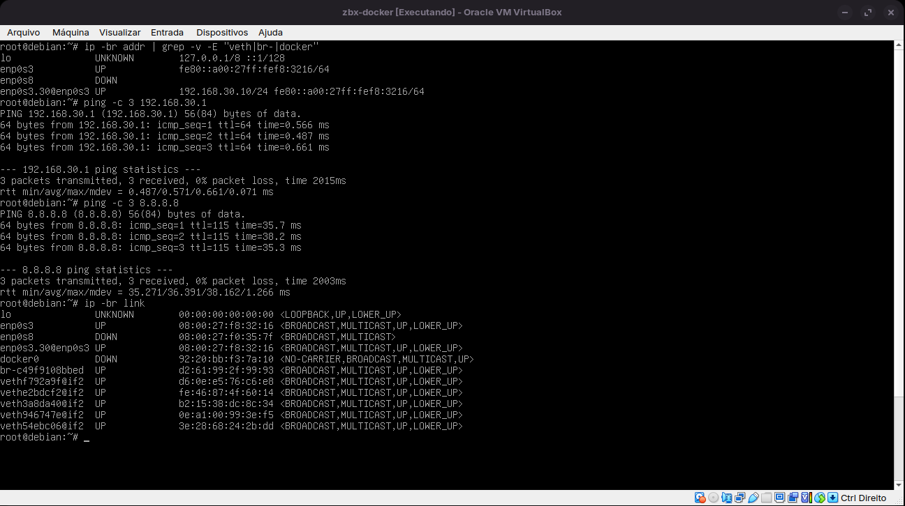
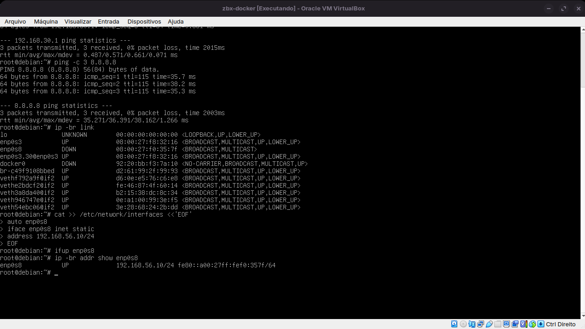
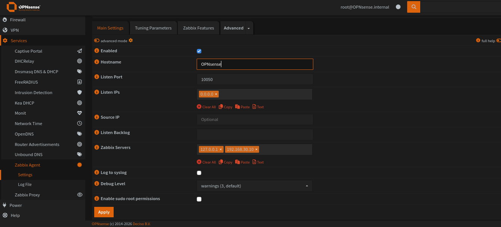
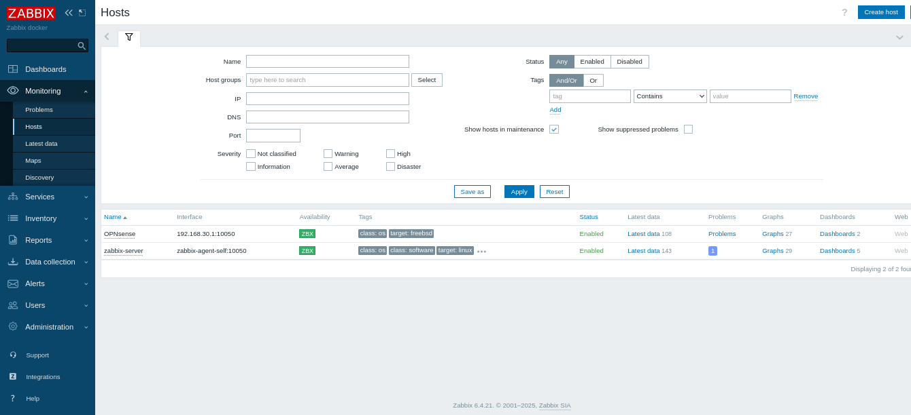
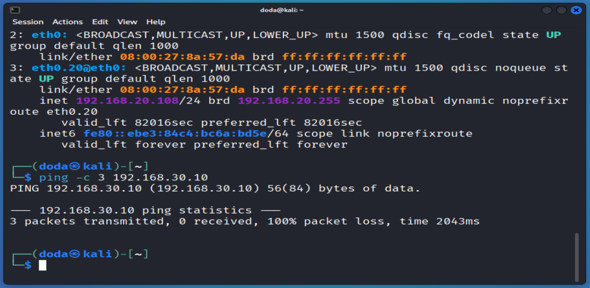

# 05 · Zabbix na VLAN 30 e monitoramento do OPNsense / Zabbix on VLAN 30 and OPNsense monitoring

[← README](../README.md) · [← 04 DHCP e firewall](04-dhcp-firewall.md)

## 🇧🇷 Português

### Objetivo
Mover o Zabbix (Docker Compose em uma VM Debian) para a VLAN 30, manter o painel acessível pelo PC por uma rede de gerência e monitorar o OPNsense com o agente do Zabbix.

### Ambiente
| Item | Valor |
|---|---|
| VM | `zbx-docker`, Debian 12 (bookworm), gerenciamento de rede por **ifupdown** (NetworkManager inativo) |
| Zabbix | 6.4.21 em Docker Compose: `zabbix-server` (10051), `zabbix-web` (porta 80), `zabbix-agent-self` (10050), `zabbix-db` (MariaDB) e Grafana (3000) |

### 1. Rede da VM (VirtualBox)
| Adaptador | Antes | Depois | Função |
|---|---|---|---|
| 1 | Bridge (rede doméstica) | **Rede Interna** `lab-lan` | Tronco; carrega a VLAN 30 |
| 2 | desabilitado | **Host-Only** `vboxnet0` | Gerência: o PC acessa o painel |

Em ambos: Intel PRO/1000 MT Desktop, Modo Promíscuo **Permitir Tudo**, cabo conectado. O MAC do adaptador 1 foi mantido, para a placa continuar se chamando `enp0s3`.

### 2. Configuração no Debian
Antes de trocar os adaptadores (ainda com internet): instalar o suporte a VLAN e carregar o módulo.
```bash
apt update && apt install -y vlan
modprobe 8021q
echo 8021q > /etc/modules-load.d/8021q.conf
```

`/etc/network/interfaces` (backup do original em `/root/interfaces.bak`):
```
source /etc/network/interfaces.d/*

auto lo
iface lo inet loopback

# Tronco da rede do lab (sem IP)
auto enp0s3
iface enp0s3 inet manual

# VLAN 30 (SERVIDORES)
auto enp0s3.30
iface enp0s3.30 inet static
    address 192.168.30.10/24
    gateway 192.168.30.1
    vlan-raw-device enp0s3

# Gerencia (Host-Only)
auto enp0s8
iface enp0s8 inet static
    address 192.168.56.10/24
```
DNS fixado em `/etc/resolv.conf`: `1.1.1.1` e `8.8.8.8`. Somente a VLAN 30 tem gateway.

### 3. Agente Zabbix no OPNsense
**Services → Zabbix Agent → Settings:**
| Campo | Valor |
|---|---|
| Enabled | marcado |
| Hostname | `OPNsense` |
| Listen Port | `10050` |
| Zabbix Servers | `127.0.0.1` e `192.168.30.10` |
| Enable sudo root permissions | desmarcado |

O serviço `zabbix_agentd` aparece rodando em **System → Diagnostics → Services**. O Zabbix consulta o agente a partir do Debian, então a origem vista pelo OPNsense é `192.168.30.10`. A regra da VLAN 30 já libera esse tráfego.

### 4. Cadastro do host no Zabbix
**Data collection → Hosts → Create host:**
| Campo | Valor |
|---|---|
| Host name | `OPNsense` |
| Templates | `FreeBSD by Zabbix agent` |
| Host groups | `Firewalls` |
| Interface (Agent) | IP `192.168.30.1`, DNS vazio, Connect to **IP**, porta `10050` |

### 5. Validação
| Teste | Esperado | Resultado obtido |
|---|---|---|
| `enp0s3.30` com `192.168.30.10/24` | Sim | **Sim** (`ip -br addr`) |
| `ping 192.168.30.1` (gateway) | Responde | **Respondeu** (3/3, 0% de perda, ~0,6 ms) |
| `ping 8.8.8.8` (internet via OPNsense) | Responde | **Respondeu** (3/3, 0% de perda, ~36 ms) |
| `enp0s8` com `192.168.56.10/24` | Sim | **Sim** |
| Painel do Zabbix em `http://192.168.56.10` | Abre | **Abriu** |
| Kali (VLAN 20): `ping 192.168.30.10` | Sem resposta | **Sem resposta** (100% de perda): a regra de bloqueio isola a VLAN 20 |
| Host OPNsense com ZBX verde no Zabbix | Sim | **Sim**, com 108 itens em *Latest data* |

**Evidências**


*Zabbix: `enp0s3.30` com `192.168.30.10/24`; gateway e internet respondendo.*


*Interface de gerência `enp0s8` com `192.168.56.10/24` (Host-Only).*


*Agente Zabbix no OPNsense (Services → Zabbix Agent → Settings).*


*Host OPNsense com a disponibilidade ZBX verde em `192.168.30.1:10050`.*


*Do Kali (VLAN 20), o ping para o Zabbix (`192.168.30.10`) não responde: a VLAN 20 não alcança a VLAN 30.*

### Problemas encontrados e soluções
| Sintoma | Causa | Solução |
|---|---|---|
| `modprobe: FATAL: Module 8201q not found` | Erro de digitação: o módulo é `8021q` | Repetir o comando com o nome correto |
| `/etc/resolv.conf` com o texto `nameserver 1.1.1.1/nnameserver 8.8.8.8/n` | No `printf` foi usada a barra normal (`/n`) em vez da invertida (`\n`) | Regravar com `printf "...\n"` ou com dois `echo` |
| Host OPNsense com ZBX vermelho e interface `127.0.0.1:10050` | O host foi criado com o IP padrão do formulário; `127.0.0.1` dentro do container é o próprio servidor, onde não há agente | Editar a interface Agent e colocar `192.168.30.1` |
| Host continuou com ZBX vermelho mesmo após editar | O IP foi digitado no campo **DNS name** e o campo **IP address** continuou `127.0.0.1` (com Connect to = IP) | Colocar `192.168.30.1` em **IP address** e deixar **DNS name** vazio |

### Pontos de melhoria
- Restringir o **Listen IPs** do agente do OPNsense (hoje `0.0.0.0`) para `192.168.30.1`.
- Restringir a regra da VLAN 30 ao tráfego necessário (porta do agente, DNS, atualizações).
- Adicionar o Kali (VLAN 20) como host monitorado: o Zabbix, na VLAN 30, inicia a conexão, que a regra libera, mesmo com a VLAN 20 bloqueada para a VLAN 30.

### Próximo passo
06 · Cadastrar o Kali no Zabbix e criar um gatilho de "host fora do ar", com o teste de alerta ao desligar a VM.

---

## 🇺🇸 English

### Goal
Move Zabbix (Docker Compose on a Debian VM) to VLAN 30, keep the dashboard reachable from the PC through a management network and monitor OPNsense with the Zabbix agent.

### Environment
| Item | Value |
|---|---|
| VM | `zbx-docker`, Debian 12 (bookworm), network managed by **ifupdown** (NetworkManager inactive) |
| Zabbix | 6.4.21 on Docker Compose: `zabbix-server` (10051), `zabbix-web` (port 80), `zabbix-agent-self` (10050), `zabbix-db` (MariaDB) and Grafana (3000) |

### 1. VM networking (VirtualBox)
| Adapter | Before | After | Role |
|---|---|---|---|
| 1 | Bridge (home network) | **Internal Network** `lab-lan` | Trunk; carries VLAN 30 |
| 2 | disabled | **Host-Only** `vboxnet0` | Management: the PC reaches the dashboard |

On both: Intel PRO/1000 MT Desktop, Promiscuous Mode **Allow All**, cable connected. Adapter 1's MAC was kept so the NIC keeps the name `enp0s3`.

### 2. Debian configuration
Before switching adapters (while still online): install VLAN support and load the module.
```bash
apt update && apt install -y vlan
modprobe 8021q
echo 8021q > /etc/modules-load.d/8021q.conf
```

`/etc/network/interfaces` (original backed up at `/root/interfaces.bak`):
```
source /etc/network/interfaces.d/*

auto lo
iface lo inet loopback

# Lab network trunk (no IP)
auto enp0s3
iface enp0s3 inet manual

# VLAN 30 (SERVIDORES)
auto enp0s3.30
iface enp0s3.30 inet static
    address 192.168.30.10/24
    gateway 192.168.30.1
    vlan-raw-device enp0s3

# Management (Host-Only)
auto enp0s8
iface enp0s8 inet static
    address 192.168.56.10/24
```
DNS fixed in `/etc/resolv.conf`: `1.1.1.1` and `8.8.8.8`. Only VLAN 30 has a gateway.

### 3. Zabbix agent on OPNsense
**Services → Zabbix Agent → Settings:**
| Field | Value |
|---|---|
| Enabled | checked |
| Hostname | `OPNsense` |
| Listen Port | `10050` |
| Zabbix Servers | `127.0.0.1` and `192.168.30.10` |
| Enable sudo root permissions | unchecked |

The `zabbix_agentd` service shows as running in **System → Diagnostics → Services**. Zabbix queries the agent from the Debian VM, so the source OPNsense sees is `192.168.30.10`. The VLAN 30 rule already allows that traffic.

### 4. Host registration in Zabbix
**Data collection → Hosts → Create host:**
| Field | Value |
|---|---|
| Host name | `OPNsense` |
| Templates | `FreeBSD by Zabbix agent` |
| Host groups | `Firewalls` |
| Interface (Agent) | IP `192.168.30.1`, DNS empty, Connect to **IP**, port `10050` |

### 5. Validation
| Test | Expected | Actual |
|---|---|---|
| `enp0s3.30` with `192.168.30.10/24` | Yes | **Yes** (`ip -br addr`) |
| `ping 192.168.30.1` (gateway) | Replies | **Replied** (3/3, 0% loss, ~0.6 ms) |
| `ping 8.8.8.8` (internet via OPNsense) | Replies | **Replied** (3/3, 0% loss, ~36 ms) |
| `enp0s8` with `192.168.56.10/24` | Yes | **Yes** |
| Zabbix dashboard at `http://192.168.56.10` | Opens | **Opened** |
| Kali (VLAN 20): `ping 192.168.30.10` | No reply | **No reply** (100% loss): the block rule isolates VLAN 20 |
| OPNsense host with green ZBX in Zabbix | Yes | **Yes**, with 108 items in *Latest data* |

**Evidence**


*Zabbix: `enp0s3.30` with `192.168.30.10/24`; gateway and internet replying.*


*Management interface `enp0s8` with `192.168.56.10/24` (Host-Only).*


*Zabbix agent on OPNsense (Services → Zabbix Agent → Settings).*


*OPNsense host with green ZBX availability at `192.168.30.1:10050`.*


*From Kali (VLAN 20), ping to Zabbix (`192.168.30.10`) gets no reply: VLAN 20 cannot reach VLAN 30.*

### Issues found and fixes
| Symptom | Cause | Fix |
|---|---|---|
| `modprobe: FATAL: Module 8201q not found` | Typo: the module is `8021q` | Re-run with the correct name |
| `/etc/resolv.conf` containing the text `nameserver 1.1.1.1/nnameserver 8.8.8.8/n` | `printf` was typed with a forward slash (`/n`) instead of a backslash (`\n`) | Rewrite it with `printf "...\n"` or with two `echo` commands |
| OPNsense host with red ZBX and interface `127.0.0.1:10050` | The host was created with the form's default IP; `127.0.0.1` inside the container is the server itself, where there is no agent | Edit the Agent interface and set `192.168.30.1` |
| Host stayed red after editing | The IP was typed in the **DNS name** field while **IP address** stayed `127.0.0.1` (with Connect to = IP) | Put `192.168.30.1` in **IP address** and leave **DNS name** empty |

### Improvements
- Restrict the OPNsense agent's **Listen IPs** (currently `0.0.0.0`) to `192.168.30.1`.
- Restrict the VLAN 30 rule to the necessary traffic (agent port, DNS, updates).
- Add Kali (VLAN 20) as a monitored host: Zabbix, on VLAN 30, initiates the connection, which the rule allows, even though VLAN 20 is blocked from VLAN 30.

### Next step
06 · Register Kali in Zabbix and create a "host down" trigger, testing the alert by powering off the VM.
