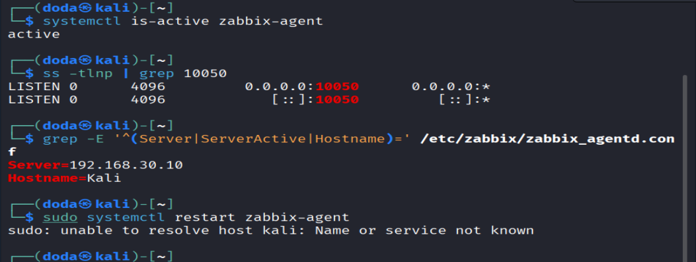
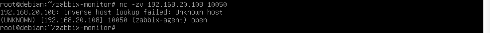
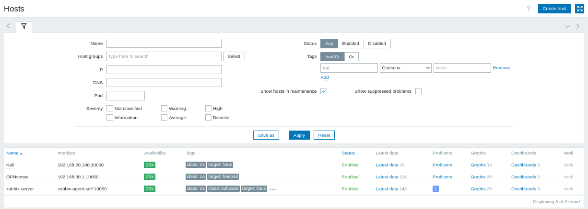
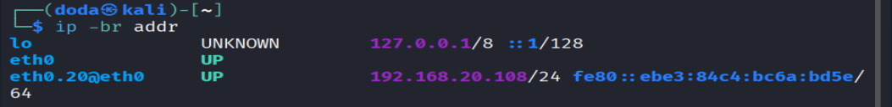

# 06 · Kali (VLAN 20) monitorado pelo Zabbix / Kali (VLAN 20) monitored by Zabbix

[← README](../README.md) · [← 05 Zabbix na VLAN 30](05-zabbix-vlan30.md)

## 🇧🇷 Português

### Objetivo
Instalar o agente do Zabbix no Kali (VLAN 20) e cadastrá-lo como host, monitorado pelo Zabbix que está na VLAN 30, sem abrir exceção no firewall.

### Por que funciona com a VLAN 20 bloqueada para a VLAN 30
Usei **verificações passivas**: o Zabbix Server (`192.168.30.10`) abre a conexão para o agente do Kali (`192.168.20.108:10050`). Quem inicia é a VLAN 30, e a regra "Servidores saem" (`vlan030 network` → any) libera. A resposta volta pelo estado da conexão. A regra que bloqueia VLAN 20 → VLAN 30 só atinge conexões iniciadas pelo Kali, e é por isso que o modo **ativo** (agente iniciando a conexão) não funcionaria aqui sem uma exceção.

### 1. Instalar e configurar o agente no Kali
```bash
sudo apt update
sudo apt install -y zabbix-agent
sudo nano /etc/zabbix/zabbix_agentd.conf
```
Valores ajustados no arquivo:
```
Server=192.168.30.10
Hostname=Kali
```
`ServerActive` ficou comentado (sem modo ativo). Iniciar e conferir:
```bash
sudo systemctl enable --now zabbix-agent
systemctl is-active zabbix-agent
ss -tlnp | grep 10050
grep -E '^(Server|ServerActive|Hostname)=' /etc/zabbix/zabbix_agentd.conf
```


*Agente `active`, porta 10050 em escuta e `Server=192.168.30.10` / `Hostname=Kali` no arquivo de configuração.*

### 2. Testar o caminho a partir da VM do Zabbix (VLAN 30)
```bash
nc -zv 192.168.20.108 10050
```


*A conexão da VLAN 30 até o agente do Kali na VLAN 20 foi aberta (`open`). O aviso `inverse host lookup failed` é só o DNS reverso do `nc`.*

### 3. Cadastrar o host no Zabbix
Caminho: **Data collection → Hosts → Create host**.

| Campo | Valor |
|---|---|
| Host name | `Kali` (igual ao `Hostname` do agente) |
| Templates | `Linux by Zabbix agent` |
| Host groups | grupo dos clientes (ex.: `Clientes`) |
| Interface Agent | IP `192.168.20.108`, **DNS name vazio**, Connect to **IP**, porta `10050` |


*Lista de hosts: Kali (`192.168.20.108:10050`), OPNsense (`192.168.30.1:10050`) e o próprio Zabbix, todos com ZBX verde. O Kali coleta 70 itens.*

### Validação
| Teste | Esperado | Resultado obtido |
|---|---|---|
| Agente ativo e escutando na porta 10050 no Kali | Sim | **Sim** (`active`, `0.0.0.0:10050`) |
| VLAN 30 alcança `192.168.20.108:10050` | Sim | **Sim** (`open`) |
| Host `Kali` com ZBX verde no Zabbix | Sim | **Sim**, 70 itens coletados |
| Coleta funciona com a VLAN 20 bloqueada para a VLAN 30 | Sim | **Sim**, sem nenhuma regra nova no firewall |
| Alerta de host fora do ar | Em até 3 min | Testado no [passo 7](07-gatilho-host-fora-do-ar.md) |

### Problemas encontrados e soluções
| Sintoma | Causa | Solução |
|---|---|---|
| `Device "etho.20" does not exist` | Erro de digitação: letra `o` no lugar do zero (`eth0.20`) | Digitar `eth0.20`; a interface estava normal |
| Kali sem rede depois de reiniciar o PC | Dúvida inicial; a conexão VLAN criada com `nmcli` fica salva | `ip -br addr` mostrou `eth0.20` UP com `192.168.20.108/24`: o DHCP e a VLAN voltaram sozinhos |
| `sudo: unable to resolve host kali` ao usar `sudo` | O hostname `kali` não tem entrada no `/etc/hosts` | Só um aviso. Opcional: `echo "127.0.1.1 kali" \| sudo tee -a /etc/hosts` |


*Depois de reiniciar o PC, o Kali voltou com `eth0.20` UP e `192.168.20.108/24`.*

### Pontos de melhoria
- Criar uma **reserva fixa** no Dnsmasq para o MAC do Kali, para o IP não mudar e o host não ser perdido no Zabbix.
- Hoje o agente escuta em `0.0.0.0`; restringir ao IP da VLAN 20 e manter `Server` apenas com o Zabbix.

### Próximo passo
[07 · Gatilho de host fora do ar e teste de alerta](07-gatilho-host-fora-do-ar.md)

---

## 🇺🇸 English

### Goal
Install the Zabbix agent on Kali (VLAN 20) and register it as a host monitored by the Zabbix server on VLAN 30, without opening a firewall exception.

### Why it works with VLAN 20 blocked from VLAN 30
I used **passive checks**: the Zabbix Server (`192.168.30.10`) opens the connection to the Kali agent (`192.168.20.108:10050`). VLAN 30 is the one initiating, and the "Servers go out" rule (`vlan030 network` → any) allows it. The reply returns through connection state. The rule blocking VLAN 20 → VLAN 30 only hits connections started by Kali, which is why **active** mode (the agent initiating) would not work here without an exception.

### 1. Install and configure the agent on Kali
```bash
sudo apt update
sudo apt install -y zabbix-agent
sudo nano /etc/zabbix/zabbix_agentd.conf
```
Values set in the file:
```
Server=192.168.30.10
Hostname=Kali
```
`ServerActive` stayed commented out (no active mode). Start and check:
```bash
sudo systemctl enable --now zabbix-agent
systemctl is-active zabbix-agent
ss -tlnp | grep 10050
grep -E '^(Server|ServerActive|Hostname)=' /etc/zabbix/zabbix_agentd.conf
```


*Agent `active`, port 10050 listening and `Server=192.168.30.10` / `Hostname=Kali` in the config file.*

### 2. Test the path from the Zabbix VM (VLAN 30)
```bash
nc -zv 192.168.20.108 10050
```


*The connection from VLAN 30 to the Kali agent on VLAN 20 was opened (`open`). The `inverse host lookup failed` message is just `nc` failing a reverse DNS lookup.*

### 3. Register the host in Zabbix
Path: **Data collection → Hosts → Create host**.

| Field | Value |
|---|---|
| Host name | `Kali` (same as the agent's `Hostname`) |
| Templates | `Linux by Zabbix agent` |
| Host groups | clients group (e.g. `Clientes`) |
| Agent interface | IP `192.168.20.108`, **DNS name empty**, Connect to **IP**, port `10050` |


*Host list: Kali (`192.168.20.108:10050`), OPNsense (`192.168.30.1:10050`) and Zabbix itself, all with green ZBX. Kali collects 70 items.*

### Validation
| Test | Expected | Actual |
|---|---|---|
| Agent running and listening on port 10050 on Kali | Yes | **Yes** (`active`, `0.0.0.0:10050`) |
| VLAN 30 reaches `192.168.20.108:10050` | Yes | **Yes** (`open`) |
| Host `Kali` with green ZBX in Zabbix | Yes | **Yes**, 70 items collected |
| Collection works with VLAN 20 blocked from VLAN 30 | Yes | **Yes**, with no new firewall rule |
| Host-down alert | Within 3 min | Tested in [step 7](07-gatilho-host-fora-do-ar.md) |

### Issues found and fixes
| Symptom | Cause | Fix |
|---|---|---|
| `Device "etho.20" does not exist` | Typo: letter `o` instead of zero (`eth0.20`) | Type `eth0.20`; the interface was fine |
| Kali seemed offline after rebooting the PC | Initial doubt; the VLAN connection created with `nmcli` is saved | `ip -br addr` showed `eth0.20` UP with `192.168.20.108/24`: DHCP and the VLAN came back on their own |
| `sudo: unable to resolve host kali` when using `sudo` | The hostname `kali` has no entry in `/etc/hosts` | Just a warning. Optional: `echo "127.0.1.1 kali" \| sudo tee -a /etc/hosts` |


*After rebooting the PC, Kali came back with `eth0.20` UP and `192.168.20.108/24`.*

### Improvements
- Create a **static reservation** in Dnsmasq for Kali's MAC so the IP does not change and the host is not lost in Zabbix.
- The agent currently listens on `0.0.0.0`; restrict it to the VLAN 20 address and keep `Server` set only to the Zabbix.

### Next step
[07 · Host-down trigger and alert test](07-gatilho-host-fora-do-ar.md)
