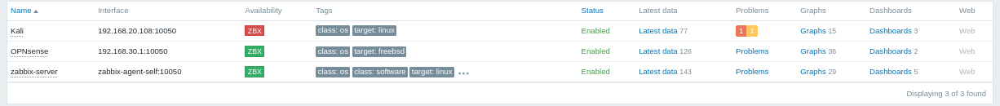
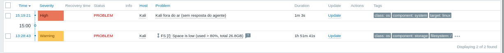
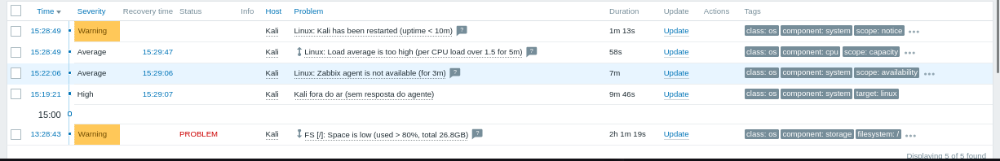

# 07 · Gatilho de host fora do ar e teste de alerta / Host-down trigger and alert test

[← README](../README.md) · [← 06 Kali no Zabbix](06-kali-no-zabbix.md)

## 🇧🇷 Português

### Objetivo
Criar um gatilho que avisa quando um host monitorado para de responder e medir quanto tempo o Zabbix leva para alertar, desligando de verdade a VM do Kali.

### 1. Gatilho
Caminho: **Data collection → Hosts → Kali → Triggers → Create trigger**.

| Campo | Valor |
|---|---|
| Name | `Kali fora do ar (sem resposta do agente)` |
| Severity | `High` |
| Expression | `nodata(/Kali/agent.ping,2m)=1` |

Ele usa o item `agent.ping` do template `Linux by Zabbix agent`, lido a cada 1 minuto. O gatilho dispara quando o Zabbix fica 2 minutos sem receber valor. Escolhi 2 minutos porque um valor menor que o intervalo de coleta geraria falsos alertas, então a meta inicial do README, "alerta em até 1 min", não era realista. Passou a ser **até 3 min** (2 min de `nodata` mais até 1 min de coleta).

### 2. Teste
1. Conferido que o Kali estava sem problemas ativos.
2. No Kali: `sudo poweroff`, às **15:17**.
3. O ZBX do Kali ficou vermelho às **15:19**.
4. Em **Monitoring → Problems**, o problema `Kali fora do ar (sem resposta do agente)` foi registrado às **15:19:21**, severidade `High`.

5. Ao ligar a VM de volta (o `top` do Kali às 15:35 marcava 8 min de uptime, então ela subiu por volta de 15:27), o problema virou **RESOLVED** às **15:29:07**.

Tempo de detecção: **cerca de 2 minutos**, dentro do esperado. O gatilho do próprio template, `Linux: Zabbix agent is not available (for 3m)`, só alertou às **15:22:06**, cerca de 2 min 45 s depois do meu.

*Depois do desligamento, o Kali aparece com ZBX vermelho e 2 problemas ativos; OPNsense e Zabbix seguem verdes.*

*Problema `Kali fora do ar (sem resposta do agente)`, severidade `High`, registrado às 15:19:21.*

*Com o Kali de volta: `Kali fora do ar` e `Zabbix agent is not available` em RESOLVED às 15:29:07 e 15:29:06. Também aparecem os avisos de reinício (`Kali has been restarted`) e de carga alta durante o boot, que se resolveram sozinhos.*

### Validação
| Teste | Esperado | Resultado obtido |
|---|---|---|
| Gatilho criado e ativo no host Kali | Sim | **Sim** |
| ZBX do Kali fica vermelho ao desligar a VM | Sim | **Sim**, às 15:19 |
| Problema `High` registrado | Em até 3 min | **Sim**, às 15:19:21 (cerca de 2 min após o desligamento às 15:17) |
| Problema resolve sozinho quando o host volta | Sim | **Sim**, RESOLVED às 15:29:07 |

### Achado extra
Na mesma tela havia outro problema ativo no Kali desde as 13:28: `FS [/]: Space is low (used > 80%, total 26.8GB)`, gerado por um gatilho do próprio template. O disco do Kali estava com mais de 80% de uso, e foi o Zabbix que mostrou isso sem eu ter configurado nada.

### Problemas encontrados e soluções
| Sintoma | Causa | Solução |
|---|---|---|
| Meta de "alerta em até 1 min" inviável | O item é lido a cada 1 min e o `nodata` precisa de uma janela maior | Meta ajustada para até 3 min, com `nodata` de 2 min |

### Pontos de melhoria
- Criar uma **ação** (Alerts → Actions) para notificar por e-mail ou mensageria quando o problema abrir. Hoje o alerta só aparece no painel.
- Liberar espaço no disco do Kali ou ajustar o limite do gatilho de espaço.

### Próximo passo
[08 · Gatilhos de CPU e de disco](08-gatilhos-cpu-disco.md)

---

## 🇺🇸 English

### Goal
Create a trigger that warns when a monitored host stops responding and measure how long Zabbix takes to alert by actually powering off the Kali VM.

### 1. Trigger
Path: **Data collection → Hosts → Kali → Triggers → Create trigger**.

| Field | Value |
|---|---|
| Name | `Kali fora do ar (sem resposta do agente)` |
| Severity | `High` |
| Expression | `nodata(/Kali/agent.ping,2m)=1` |

It uses the `agent.ping` item from the `Linux by Zabbix agent` template, read every 1 minute. The trigger fires when Zabbix gets no value for 2 minutes. I chose 2 minutes because a window shorter than the polling interval would cause false alerts, so the README's original goal, "alert within 1 min", was not realistic. It became **within 3 min** (2 min of `nodata` plus up to 1 min of polling).

### 2. Test
1. Confirmed Kali had no active problems.
2. On Kali: `sudo poweroff`, at **15:17**.
3. Kali's ZBX turned red at **15:19**.
4. In **Monitoring → Problems**, the problem `Kali fora do ar (sem resposta do agente)` was logged at **15:19:21**, severity `High`.

5. When the VM was powered back on (Kali's `top` at 15:35 showed 8 min of uptime, so it came up around 15:27), the problem turned **RESOLVED** at **15:29:07**.

Detection time: **about 2 minutes**, as expected. The template's own trigger, `Linux: Zabbix agent is not available (for 3m)`, only alerted at **15:22:06**, about 2 min 45 s after mine.

*After the shutdown, Kali shows a red ZBX and 2 active problems; OPNsense and Zabbix stay green.*

*Problem `Kali fora do ar (sem resposta do agente)`, severity `High`, logged at 15:19:21.*

*With Kali back: `Kali fora do ar` and `Zabbix agent is not available` RESOLVED at 15:29:07 and 15:29:06. The restart notice (`Kali has been restarted`) and the high load warning during boot also show up and cleared by themselves.*

### Validation
| Test | Expected | Actual |
|---|---|---|
| Trigger created and enabled on host Kali | Yes | **Yes** |
| Kali's ZBX turns red when the VM is powered off | Yes | **Yes**, at 15:19 |
| `High` problem logged | Within 3 min | **Yes**, at 15:19:21 (about 2 min after the 15:17 shutdown) |
| Problem resolves by itself when the host returns | Yes | **Yes**, RESOLVED at 15:29:07 |

### Extra finding
The same screen showed another active problem on Kali since 13:28: `FS [/]: Space is low (used > 80%, total 26.8GB)`, raised by a trigger from the template itself. Kali's disk was over 80% full, and Zabbix surfaced it without any configuration from me.

### Issues found and fixes
| Symptom | Cause | Fix |
|---|---|---|
| The "alert within 1 min" goal was not feasible | The item is polled every 1 min and `nodata` needs a larger window | Goal adjusted to within 3 min, with a 2 min `nodata` |

### Improvements
- Create an **action** (Alerts → Actions) to notify by e-mail or messaging when the problem opens. Today the alert only shows on the dashboard.
- Free disk space on Kali or tune the space trigger threshold.

### Next step
[08 · CPU and disk triggers](08-gatilhos-cpu-disco.md)
