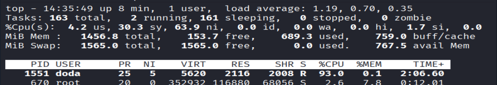
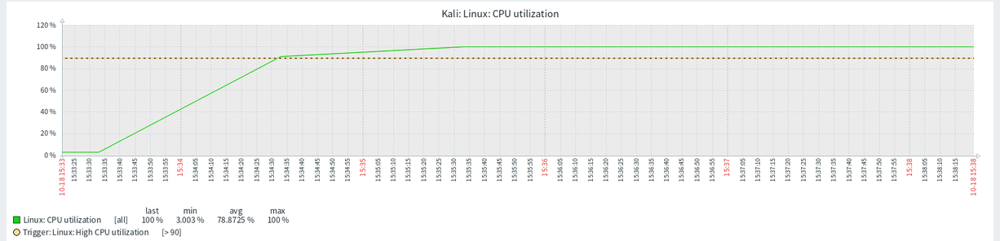
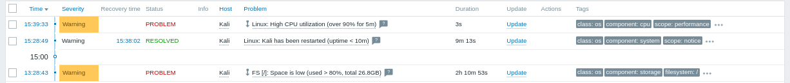
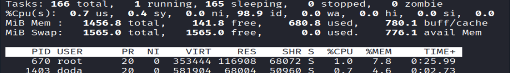
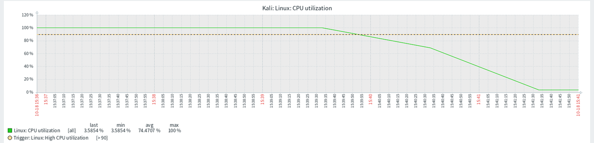
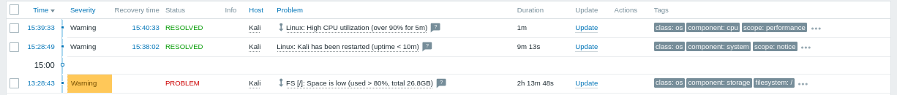

# 08 · Gatilhos de CPU e de disco / CPU and disk triggers

[← README](../README.md) · [← 07 Gatilho de host fora do ar](07-gatilho-host-fora-do-ar.md)

## 🇧🇷 Português

### Objetivo
Validar os alertas de **CPU alta** e de **pouco espaço em disco** no Kali. Os dois já vêm no template `Linux by Zabbix agent`, então não precisei criá-los: o teste foi provar que disparam e resolvem de verdade.

### 1. CPU alta
Gatilho do template: `Linux: High CPU utilization (over 90% for 5m)`, com severidade `Warning`. Ele usa a **média de 5 minutos** da utilização de CPU, lida a cada 1 minuto.

**Teste:** a VM do Kali tem **1 núcleo** (`nproc` = 1), então um único processo `yes` já a satura:
```bash
nproc
for i in $(seq $(nproc)); do yes > /dev/null & done
top
```
Para parar a carga:
```bash
pkill yes
```


*`nproc` = 1 e o `yes` iniciado em segundo plano (PID 1551), às 15:33.*


*`top` com o `yes` usando 93% da CPU, em 63,9% de tempo `ni` (processo com prioridade reduzida) e 0% ocioso.*


*Gráfico `Linux: CPU utilization` no Zabbix: sobe a partir das 15:33 e passa da linha tracejada do gatilho (90%) por volta de 15:34:30.*


*Problema `Linux: High CPU utilization (over 90% for 5m)` registrado às **15:39:33**, severidade `Warning`.*

Parei a carga por volta das 15:40 e o Zabbix confirmou a recuperação:


*Depois do `pkill yes`: 98,9% da CPU ociosa.*


*A utilização cai de 100% para perto de 3% em cerca de 2 minutos.*


*O problema de CPU alta aparece como **RESOLVED** às **15:40:33**, depois de 1 minuto de duração.*

**Tempos medidos**

| Evento | Horário |
|---|---|
| Carga iniciada (`yes`) | 15:33 |
| CPU passa de 90% no gráfico | cerca de 15:34:30 |
| Alerta registrado | **15:39:33** (cerca de 6 min depois do início) |
| Carga parada (`pkill yes`) | cerca de 15:40 |
| Alerta resolvido | **15:40:33** |

O atraso de cerca de 5 minutos entre a CPU passar de 90% e o alerta é esperado, porque o gatilho avalia a **média de 5 minutos**: ele só dispara quando a janela inteira está acima do limite.

### 2. Pouco espaço em disco
Gatilho do template: `Linux: FS [/]: Space is low (used > 80%, total 26.8GB)`, severidade `Warning`, a partir de 80% de uso do sistema de arquivos `/`.

Aqui não foi preciso forçar um teste: o disco do Kali já estava acima de 80% e o alerta está ativo desde as **13:28:43**. Ele continuou aberto durante toda a sessão, inclusive depois da recuperação da CPU (veja a última linha dos prints de Problems acima), o que mostra que o gatilho de disco é independente dos demais e segue ativo enquanto a condição existir.

### Validação
| Teste | Esperado | Resultado obtido |
|---|---|---|
| CPU saturada por 5 min gera alerta | Sim | **Sim**, às 15:39:33 (carga iniciada às 15:33) |
| Alerta de CPU resolve quando a carga para | Sim | **Sim**, às 15:40:33 |
| Disco acima de 80% gera alerta | Sim | **Sim**, ativo desde 13:28:43 |

### Problemas encontrados e soluções
| Sintoma | Causa | Solução |
|---|---|---|
| Horário em que notei a recuperação (15:42) diferente do registrado no Zabbix (15:40:33) | Eu só olhei a tela depois de alguns minutos | Usar o horário do Zabbix (**Recovery time**) como referência |

### Pontos de melhoria
- Notificar por mensageria quando um problema abrir: feito no [passo 9](09-notificacao-telegram.md), com o Telegram.
- Liberar espaço no disco do Kali ou ajustar o limite do gatilho de espaço.
- Para um alerta de CPU mais rápido em produção, reduzir a janela da média ou o limite, ao custo de mais alertas falsos.

---

## 🇺🇸 English

### Goal
Validate the **high CPU** and **low disk space** alerts on Kali. Both already ship with the `Linux by Zabbix agent` template, so I did not need to create them: the test was proving they really fire and resolve.

### 1. High CPU
Template trigger: `Linux: High CPU utilization (over 90% for 5m)`, severity `Warning`. It uses the **5-minute average** of CPU utilization, read every 1 minute.

**Test:** the Kali VM has **1 core** (`nproc` = 1), so a single `yes` process already saturates it:
```bash
nproc
for i in $(seq $(nproc)); do yes > /dev/null & done
top
```
To stop the load:
```bash
pkill yes
```


*`nproc` = 1 and `yes` started in the background (PID 1551), at 15:33.*


*`top` with `yes` using 93% CPU, 63.9% in `ni` time (lowered-priority process) and 0% idle.*


*`Linux: CPU utilization` graph in Zabbix: it rises from 15:33 and crosses the trigger's dashed line (90%) around 15:34:30.*


*Problem `Linux: High CPU utilization (over 90% for 5m)` logged at **15:39:33**, severity `Warning`.*

I stopped the load around 15:40 and Zabbix confirmed the recovery:


*After `pkill yes`: 98.9% of the CPU idle.*


*Utilization drops from 100% to about 3% in roughly 2 minutes.*


*The high CPU problem shows as **RESOLVED** at **15:40:33**, after a 1-minute duration.*

**Measured times**

| Event | Time |
|---|---|
| Load started (`yes`) | 15:33 |
| CPU crosses 90% on the graph | around 15:34:30 |
| Alert logged | **15:39:33** (about 6 min after the start) |
| Load stopped (`pkill yes`) | around 15:40 |
| Alert resolved | **15:40:33** |

The delay of about 5 minutes between CPU crossing 90% and the alert is expected, because the trigger evaluates the **5-minute average**: it only fires when the whole window is above the threshold.

### 2. Low disk space
Template trigger: `Linux: FS [/]: Space is low (used > 80%, total 26.8GB)`, severity `Warning`, from 80% usage of the `/` filesystem.

No forced test was needed here: Kali's disk was already above 80% and the alert has been active since **13:28:43**. It stayed open throughout the session, including after the CPU recovery (see the last row of the Problems screenshots above), which shows the disk trigger is independent from the others and stays active while the condition lasts.

### Validation
| Test | Expected | Actual |
|---|---|---|
| CPU saturated for 5 min raises an alert | Yes | **Yes**, at 15:39:33 (load started at 15:33) |
| CPU alert resolves when the load stops | Yes | **Yes**, at 15:40:33 |
| Disk above 80% raises an alert | Yes | **Yes**, active since 13:28:43 |

### Issues found and fixes
| Symptom | Cause | Fix |
|---|---|---|
| The time I noticed the recovery (15:42) differed from what Zabbix logged (15:40:33) | I only looked at the screen a few minutes later | Use Zabbix's time (**Recovery time**) as the reference |

### Improvements
- Notify by messaging when a problem opens: done in [step 9](09-notificacao-telegram.md), with Telegram.
- Free disk space on Kali or tune the space trigger threshold.
- For a faster CPU alert in production, shorten the averaging window or lower the threshold, at the cost of more false alerts.
