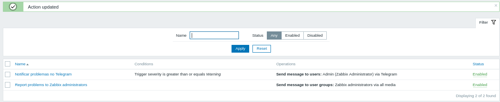
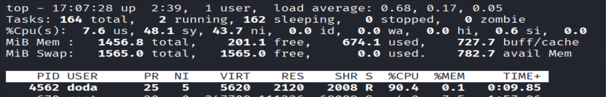
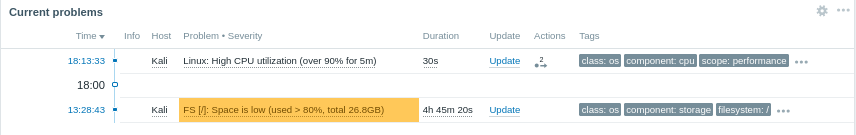
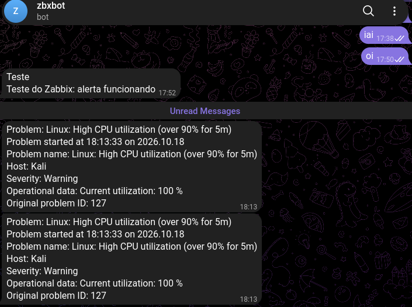
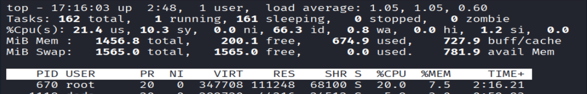
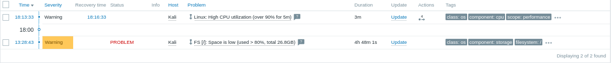
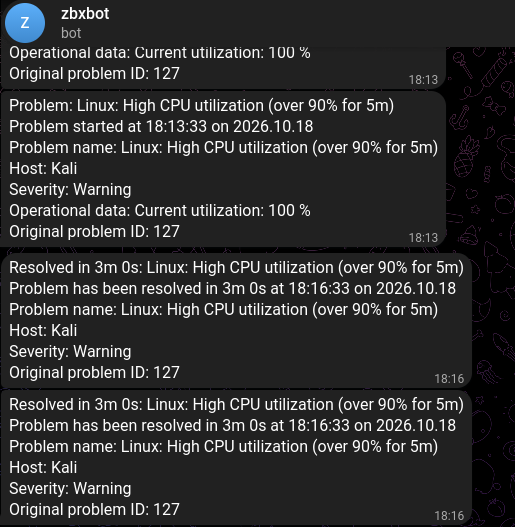

# 09 · Notificações no Telegram / Telegram notifications

[← README](../README.md) · [← 08 Gatilhos de CPU e disco](08-gatilhos-cpu-disco.md)

## 🇧🇷 Português

### Objetivo
Fazer o Zabbix avisar no celular quando um problema abre e quando ele resolve, usando um bot do Telegram. Até aqui os alertas só apareciam no painel.

> O **token** do bot funciona como senha. Neste repositório ele nunca aparece, e o Chat ID também não: use `<TOKEN>` e `<CHAT_ID>` nos exemplos.

### 1. Criar o bot
1. No Telegram, conversar com **@BotFather**, enviar `/newbot` e escolher nome e usuário (terminado em `bot`). Ele devolve o **token**.
2. Abrir o chat **do bot criado** (não o do BotFather) e enviar uma mensagem. Sem isso o bot não consegue mandar mensagens para você.
3. Conferir o token e descobrir o Chat ID no navegador:
   ```
   https://api.telegram.org/bot<TOKEN>/getMe
   https://api.telegram.org/bot<TOKEN>/getUpdates
   ```
   O `getMe` deve trazer `"ok": true`. No `getUpdates`, o Chat ID é o `id` dentro de `chat`.

### 2. Configurar o Zabbix
1. **Alerts → Media types → Telegram:** colar o token no parâmetro `Token`, marcar **Enabled** e salvar. O botão **Test** (com o Chat ID em `To`) envia uma mensagem de teste.
2. **Users → Users → Admin → Media → Add:** `Type` = `Telegram`, `Send to` = `<CHAT_ID>`.
3. **Alerts → Actions → Trigger actions → Create action:**
   - **Name:** `Notificar problemas no Telegram`
   - **Conditions:** `Trigger severity` maior ou igual a `Warning`
   - **Operations** e **Recovery operations:** `Send message to users` → `Admin` via `Telegram`


*Ação `Notificar problemas no Telegram` criada, com condição de severidade `Warning` ou maior, enviando ao usuário `Admin` via Telegram. A ação padrão do Zabbix aparece logo abaixo.*

### 3. Teste de ponta a ponta
Mesmo teste de CPU do [passo 8](08-gatilhos-cpu-disco.md), agora com notificação:
```bash
for i in $(seq $(nproc)); do yes > /dev/null & done   # carga às 18:07
pkill yes                                             # parada às 18:16
```


*`top` no Kali com o `yes` a 90,4% de CPU e quase nada ocioso.*


*`Linux: High CPU utilization (over 90% for 5m)` aberto às 18:13:33 no painel do Zabbix.*


*Mensagem de **problema** no Telegram, às 18:13, com o horário de início, o host, a severidade e a utilização atual (100%).*

Depois do `pkill yes`:


*`top` no Kali com 66,3% de CPU ociosa, sem o `yes`.*


*O problema aparece como resolvido às 18:16:33, depois de 3 minutos.*


*Mensagem de **resolvido** no Telegram, às 18:16, informando `Resolved in 3m 0s`.*

**Tempos medidos**

| Evento | Horário |
|---|---|
| Carga iniciada | 18:07 |
| Problema aberto no Zabbix | **18:13:33** |
| Mensagem de problema no Telegram | 18:13 |
| Carga parada (`pkill yes`) | 18:16 |
| Problema resolvido no Zabbix | **18:16:33** |
| Mensagem de resolvido no Telegram | 18:16 |

### Validação
| Teste | Esperado | Resultado obtido |
|---|---|---|
| Teste do tipo de mídia Telegram | Mensagem chega no bot | **Sim** (`Media type test successful`, `Response: OK`) |
| Problema abre e notifica no Telegram | Mensagem no mesmo minuto | **Sim**, às 18:13 (problema às 18:13:33) |
| Resolução notifica no Telegram | Mensagem no mesmo minuto | **Sim**, às 18:16 (resolvido às 18:16:33) |

### Problemas encontrados e soluções
| Sintoma | Causa | Solução |
|---|---|---|
| `404 Not Found` ao abrir `api.telegram.org/bot.../getUpdates` | A URL tinha o **nome do bot entre `< >`** no lugar do token | O texto depois de `bot` é o token, colado e sem `< >`. Confirmar com `getMe` |
| O `/start` só mostrava a lista de comandos | A conversa aberta era a do **BotFather**, não a do bot criado | Abrir o chat do próprio bot (`@nome_do_bot`) e enviar a mensagem lá |
| `getUpdates` com `"result": []` | O bot ainda não tinha recebido nenhuma mensagem | Enviar uma mensagem ao bot e atualizar a página |
| Token do bot apareceu em um print | Print tirado do BotFather com o token visível | Revogar com `/revoke` no BotFather, usar o token novo e não publicar prints com ele |
| Cada mensagem chega **duas vezes** | O Zabbix já traz a ação `Report problems to Zabbix administrators`, e o `Admin` (que está nesse grupo) agora recebe também pelo Telegram | Desativar a ação padrão em **Alerts → Actions → Trigger actions** (selecionar e **Disable**) |

### Pontos de melhoria
- Desativar a ação padrão para acabar com as mensagens duplicadas.
- Usar um **grupo do Telegram** com o bot, para notificar mais de uma pessoa, em vez de um chat privado.
- Escalar por severidade: `High` e `Disaster` com mensagem a mais pessoas ou repetição.
- Guardar o token em uma macro secreta do Zabbix em vez de deixá-lo no campo do tipo de mídia.

### Próximo passo
[10 · VPN WireGuard: ADMIN → Servidores](10-wireguard-admin-servidores.md)

---

## 🇺🇸 English

### Goal
Make Zabbix notify on the phone when a problem opens and when it resolves, using a Telegram bot. Until now alerts only showed on the dashboard.

> The bot **token** works like a password. It never appears in this repository, and neither does the Chat ID: examples use `<TOKEN>` and `<CHAT_ID>`.

### 1. Create the bot
1. On Telegram, talk to **@BotFather**, send `/newbot` and pick a name and a username (ending in `bot`). It returns the **token**.
2. Open the chat **of the bot you created** (not BotFather's) and send a message. Without this the bot cannot message you.
3. Check the token and find the Chat ID in the browser:
   ```
   https://api.telegram.org/bot<TOKEN>/getMe
   https://api.telegram.org/bot<TOKEN>/getUpdates
   ```
   `getMe` should return `"ok": true`. In `getUpdates`, the Chat ID is the `id` inside `chat`.

### 2. Configure Zabbix
1. **Alerts → Media types → Telegram:** paste the token into the `Token` parameter, tick **Enabled** and save. The **Test** button (with the Chat ID in `To`) sends a test message.
2. **Users → Users → Admin → Media → Add:** `Type` = `Telegram`, `Send to` = `<CHAT_ID>`.
3. **Alerts → Actions → Trigger actions → Create action:**
   - **Name:** `Notificar problemas no Telegram`
   - **Conditions:** `Trigger severity` greater than or equal to `Warning`
   - **Operations** and **Recovery operations:** `Send message to users` → `Admin` via `Telegram`


*Action `Notificar problemas no Telegram` created, with a severity `Warning` or higher condition, sending to user `Admin` via Telegram. Zabbix's default action shows just below.*

### 3. End-to-end test
Same CPU test as [step 8](08-gatilhos-cpu-disco.md), now with notification:
```bash
for i in $(seq $(nproc)); do yes > /dev/null & done   # load at 18:07
pkill yes                                             # stopped at 18:16
```


*`top` on Kali with `yes` at 90.4% CPU and almost nothing idle.*


*`Linux: High CPU utilization (over 90% for 5m)` opened at 18:13:33 on the Zabbix dashboard.*


*The **problem** message on Telegram, at 18:13, with the start time, host, severity and current utilization (100%).*

After `pkill yes`:


*`top` on Kali with 66.3% idle CPU, without `yes`.*


*The problem shows as resolved at 18:16:33, after 3 minutes.*


*The **resolved** message on Telegram, at 18:16, saying `Resolved in 3m 0s`.*

**Measured times**

| Event | Time |
|---|---|
| Load started | 18:07 |
| Problem opened in Zabbix | **18:13:33** |
| Problem message on Telegram | 18:13 |
| Load stopped (`pkill yes`) | 18:16 |
| Problem resolved in Zabbix | **18:16:33** |
| Resolved message on Telegram | 18:16 |

### Validation
| Test | Expected | Actual |
|---|---|---|
| Telegram media type test | Message reaches the bot | **Yes** (`Media type test successful`, `Response: OK`) |
| Problem opens and notifies on Telegram | Message within the same minute | **Yes**, at 18:13 (problem at 18:13:33) |
| Resolution notifies on Telegram | Message within the same minute | **Yes**, at 18:16 (resolved at 18:16:33) |

### Issues found and fixes
| Symptom | Cause | Fix |
|---|---|---|
| `404 Not Found` opening `api.telegram.org/bot.../getUpdates` | The URL had the **bot name inside `< >`** instead of the token | The text after `bot` is the token, pasted with no `< >`. Check with `getMe` |
| `/start` only showed the command list | The open conversation was **BotFather's**, not the created bot's | Open the bot's own chat (`@bot_name`) and send the message there |
| `getUpdates` with `"result": []` | The bot had not received any message yet | Send a message to the bot and refresh the page |
| The bot token showed up in a screenshot | Screenshot of BotFather with the token visible | Revoke with `/revoke` in BotFather, use the new token and do not publish screenshots with it |
| Every message arrives **twice** | Zabbix ships with the `Report problems to Zabbix administrators` action, and `Admin` (in that group) now also receives via Telegram | Disable the default action under **Alerts → Actions → Trigger actions** (select and **Disable**) |

### Improvements
- Disable the default action to stop the duplicate messages.
- Use a **Telegram group** with the bot to notify more than one person, instead of a private chat.
- Escalate by severity: `High` and `Disaster` messaging more people or repeating.
- Keep the token in a Zabbix secret macro instead of the media type field.

### Next step
[10 · WireGuard VPN: ADMIN → Servers](10-wireguard-admin-servidores.md)
