# 10 · VPN WireGuard: ADMIN → Servidores / WireGuard VPN: ADMIN → Servers

[← README](../README.md) · [← 09 Notificações no Telegram](09-notificacao-telegram.md)

## 🇧🇷 Português

### Objetivo
Para deixar o lab mais completo, adicionei uma **VPN WireGuard direto no OPNsense**, para mostrar como seria o acesso administrativo aos servidores em um ambiente de verdade: o administrador não "entra" na rede de servidores por uma regra aberta entre VLANs, ele abre um **túnel cifrado e autenticado por chaves** até o firewall e só então alcança a VLAN 30.

### Desenho
| Item | Valor |
|---|---|
| Servidor WireGuard | OPNsense, instância `wg-admin` (`wg0`), `10.10.10.1/24`, UDP `51820` |
| Cliente | Kali na VLAN 10 (`eth0.10`, `192.168.10.108`), túnel `10.10.10.2/24` |
| Peer no OPNsense | `kali-admin`, Allowed IPs `10.10.10.2/32`, keepalive 25 s |
| Endpoint usado pelo cliente | `192.168.10.1:51820` (IP do OPNsense na VLAN 10) |
| Destino alcançado pelo túnel | VLAN 30 (`192.168.30.0/24`) |

Fluxo: Kali (VLAN 10) → UDP 51820 → OPNsense → túnel `10.10.10.0/24` → regra do grupo WireGuard → VLAN 30.

O acesso **direto** da VLAN 10 à VLAN 30 é bloqueado por uma regra no firewall: a única via é o túnel.

> **Segurança:** as chaves **privadas** (a do Kali e a do OPNsense) nunca aparecem neste repositório; os prints as mostram como `(hidden)` e o arquivo de configuração usa `<CHAVE_PRIVADA_DO_KALI>`. As chaves **públicas** não são segredo.

### 1. Servidor no OPNsense
Caminho: **VPN → WireGuard**.

1. **Instances → +**: nome `wg-admin`, porta `51820`, endereço do túnel `10.10.10.1/24`. Ao salvar, o OPNsense gera o par de chaves; anote a **Public key** da instância.
2. **Peers → +**: nome `kali-admin`, **Public key** do Kali, **Allowed IPs** `10.10.10.2/32`, instância `wg-admin`, keepalive `25`. Endpoint em branco (é o Kali que inicia).
3. Em **Instances**, marcar **Enable WireGuard** (fica abaixo da tabela, não existe aba *General* nesta versão) e clicar **Apply**.

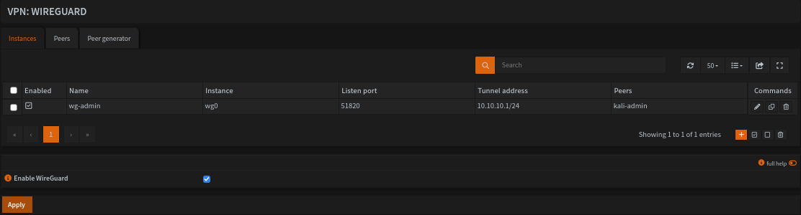
*Instância `wg-admin` (`wg0`, porta 51820, `10.10.10.1/24`, peer `kali-admin`) e a caixa **Enable WireGuard** marcada.*

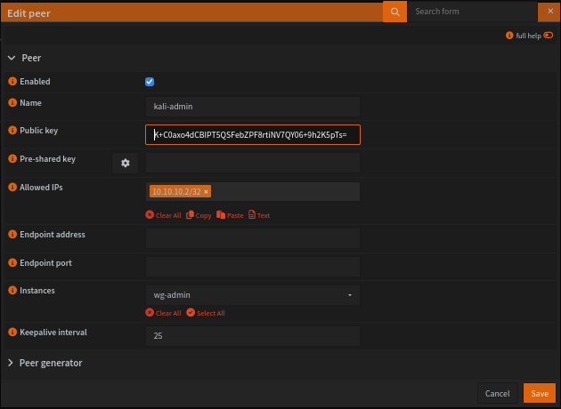
*Peer `kali-admin`: chave pública do Kali, Allowed IPs `10.10.10.2/32`, instância `wg-admin`, keepalive 25.*

### 2. Regras de firewall
| Onde | Ação | Origem | Destino | Para quê |
|---|---|---|---|---|
| **ADMIN** (`vlan010`) | Pass, UDP | `vlan010 net` | `This Firewall`, porta `51820` | Deixar o Kali chegar ao servidor WireGuard |
| **ADMIN** (`vlan010`) | **Block** | `vlan010 net` | `vlan030 net` | Impedir o acesso direto à VLAN 30; precisa ficar **acima** da regra "Admin acessa tudo" |
| **WireGuard (Group)** | Pass | `10.10.10.0/24` | `vlan030 net` | O que o túnel pode alcançar |
| **WireGuard (Group)** | Pass | `10.10.10.0/24` | `This Firewall` | Testar o próprio túnel (`10.10.10.1`) |

As regras são lidas de cima para baixo e vale a primeira que combina, por isso o **Block** fica acima da "Admin acessa tudo". O tráfego que **sai do túnel** é filtrado na aba **WireGuard (Group)**. Sem regra ali, o OPNsense bloqueia tudo, mesmo com o handshake feito. **Apply changes** é obrigatório depois de salvar (ver problemas).

### 3. Cliente no Kali (VLAN 10)
```bash
sudo apt install -y wireguard
umask 077
wg genkey | tee ~/kali.key | wg pubkey > ~/kali.pub   # ~/kali.key é segredo
cat ~/kali.pub                                         # esta vai para o peer no OPNsense
```
`/etc/wireguard/wg0.conf` (permissão `600`):
```ini
[Interface]
Address    = 10.10.10.2/24
PrivateKey = <CHAVE_PRIVADA_DO_KALI>

[Peer]
PublicKey           = <CHAVE_PUBLICA_DA_INSTANCIA_wg-admin>
Endpoint            = 192.168.10.1:51820
AllowedIPs          = 10.10.10.0/24, 192.168.30.0/24
PersistentKeepalive = 25
```
Subir e conferir:
```bash
sudo wg-quick up wg0
sudo wg show
```
`AllowedIPs` define **o que vai pelo túnel**: a rede do próprio túnel e a VLAN 30. Ele também cria a rota `192.168.30.0/24 dev wg0`.

### 4. Validação
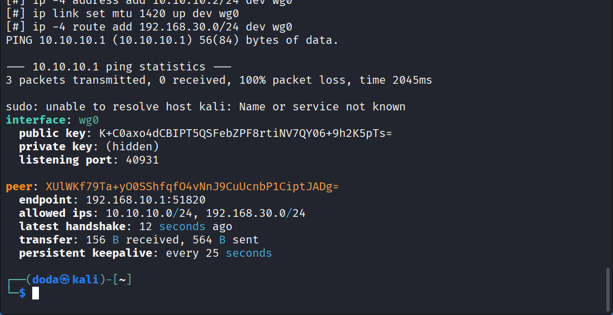
*`sudo wg show` no Kali: peer com endpoint `192.168.10.1:51820` e `latest handshake` de poucos segundos.*

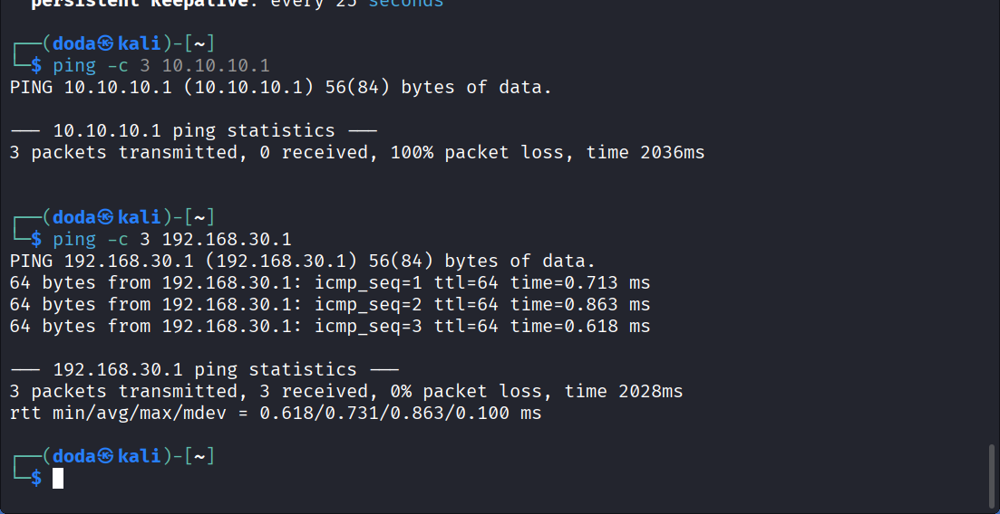
*`ping 192.168.30.1`: 3/3 respostas, 0% de perda (~0,6 a 0,9 ms). Neste print o ping ao `10.10.10.1` ainda falhava: faltava aplicar a regra `This Firewall` do grupo WireGuard (ver problemas).*

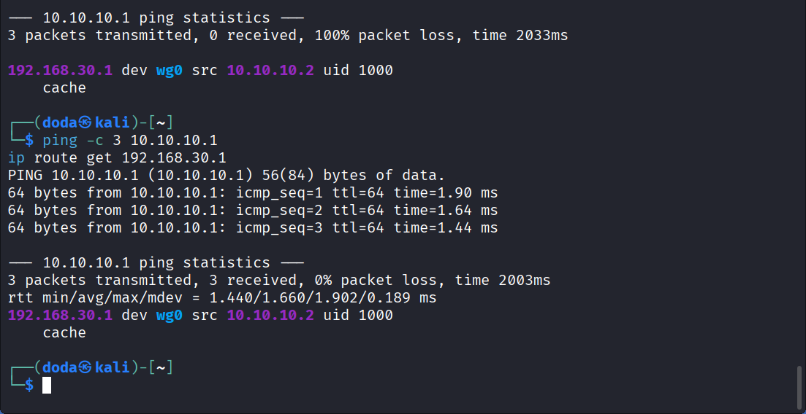
*Depois do **Apply changes**: `ping 10.10.10.1` 3/3 (~1,4 a 1,9 ms). `ip route get 192.168.30.1` mostra `dev wg0 src 10.10.10.2`: o caminho para a VLAN 30 é o túnel.*

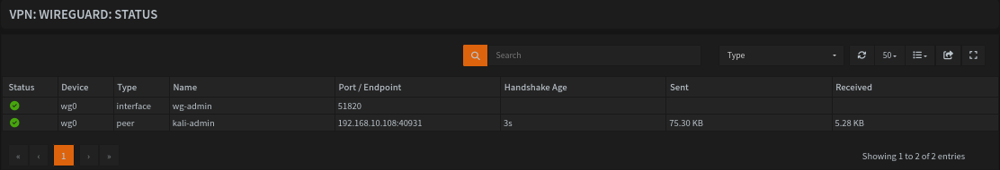
*VPN → WireGuard → Status: `wg0` e o peer `kali-admin` verdes, endpoint `192.168.10.108`, handshake de 3 s, tráfego nos dois sentidos.*

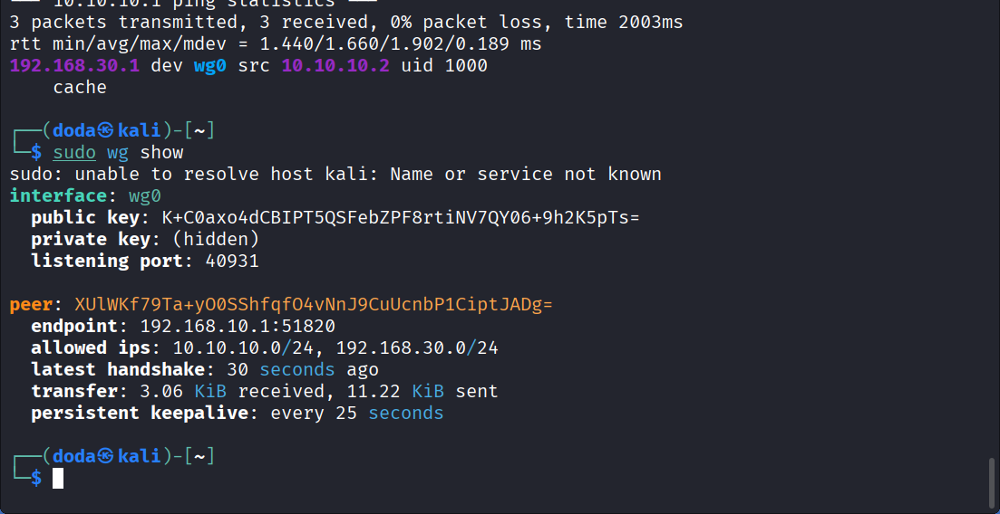
*Estado final no Kali: handshake recente e bytes recebidos e enviados (`private key` aparece como `(hidden)`).*

| Teste | Esperado | Resultado obtido |
|---|---|---|
| Handshake Kali ↔ OPNsense | Peer verde e `latest handshake` recente | **Sim**: verde no Status, handshake de segundos |
| Ping ao OPNsense pelo túnel (`10.10.10.1`) | Sucesso | **Sucesso**: 3/3, 0% de perda (~1,4 a 1,9 ms) |
| Ping à VLAN 30 (`192.168.30.1`) | Sucesso | **Sucesso**: 3/3, 0% de perda (~0,6 a 0,9 ms) |
| Caminho até a VLAN 30 | Pelo `wg0` | **Sim**: `ip route get` → `dev wg0 src 10.10.10.2` |

### 5. Só pela VPN: o acesso direto é bloqueado
Para provar que o túnel é o único caminho, bloqueei a VLAN 10 → VLAN 30 e testei os dois caminhos. Antes da regra existir, o ping direto da VLAN 10 à VLAN 30 funcionava (3/3, com uma rota temporária pela `eth0.10`), porque a regra de acesso total da ADMIN o permitia.

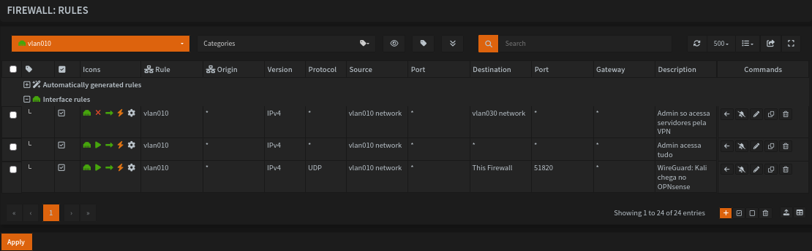
*Regras da ADMIN, na ordem: **Block** `vlan010 network → vlan030 network` (descrição "Admin so acessa servidores pela VPN"), "Admin acessa tudo" e o Pass UDP 51820.*

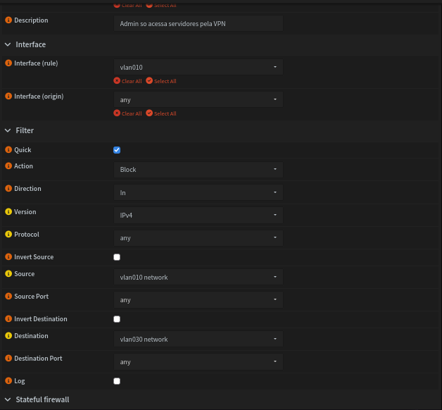
*Detalhe: ação **Block**, interface `vlan010`, direção `In`, protocolo `any`, origem `vlan010 network`, destino `vlan030 network`, `Quick` marcado.*

Teste no Kali, **sem o túnel** e com uma rota temporária pela `eth0.10`, para forçar o caminho direto:
```bash
sudo wg-quick down wg0
sudo ip route add 192.168.30.0/24 via 192.168.10.1 dev eth0.10
ping -c 3 -I eth0.10 192.168.30.1
```
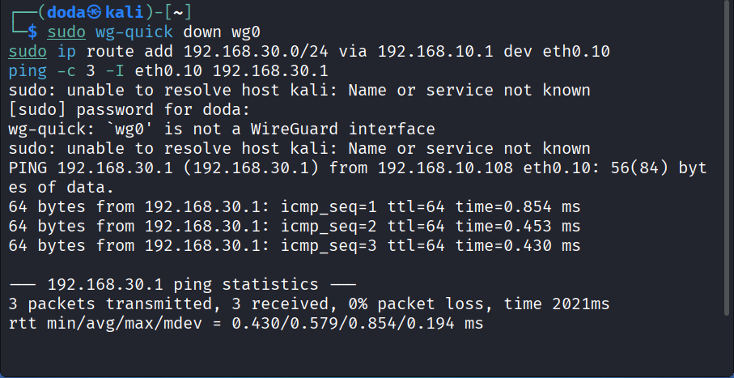
*Primeira tentativa, com a regra Block já criada e aplicada, mas com estado de conexão antigo no firewall: o ping direto (origem `192.168.10.108`, `eth0.10`) ainda responde, 3/3. O `wg0 is not a WireGuard interface` só indica que o túnel já estava desligado.*

Depois de **Reset states** (Firewall → Diagnostics → States):

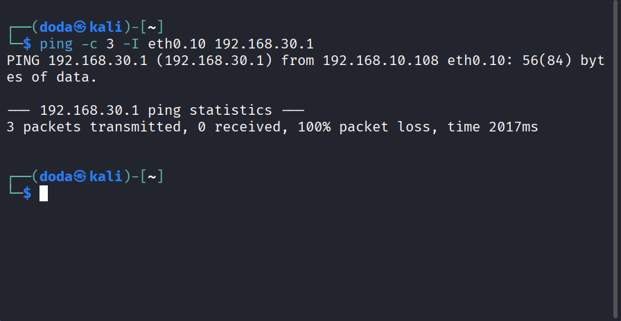
*Ping direto pela VLAN 10: **100% de perda**, sem `Host Unreachable` (o pacote sai e o firewall o descarta).*

Em seguida, remover a rota temporária e subir o túnel:
```bash
sudo ip route del 192.168.30.0/24
sudo wg-quick up wg0
ping -c 3 192.168.30.1
ip route get 192.168.30.1
sudo wg show
```
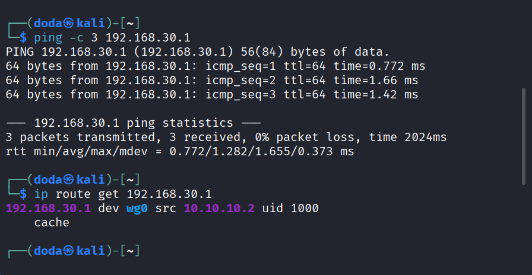
*Com o Block ativo, o ping pelo túnel responde 3/3 (0% de perda, ~0,4 a 1,7 ms) e `ip route get` mostra `dev wg0 src 10.10.10.2`.*

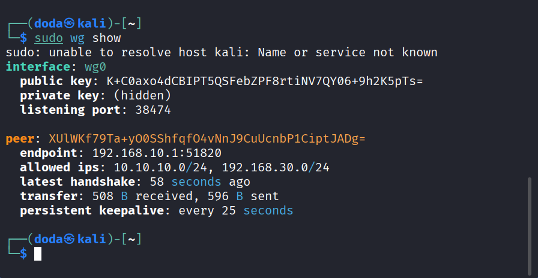
*`sudo wg show`: handshake recente e tráfego nos dois sentidos.*

**Como saber por onde o pacote vai.** O `ping` só mostra o destino e a resposta; quem escolhe o caminho é a tabela de rotas. Dois comandos deixam isso explícito:
```bash
ip route get 192.168.30.1          # dev wg0 = túnel; dev eth0.10 = direto pela VLAN 10
ping -c 3 -I wg0 192.168.30.1      # força o ping pelo túnel
```
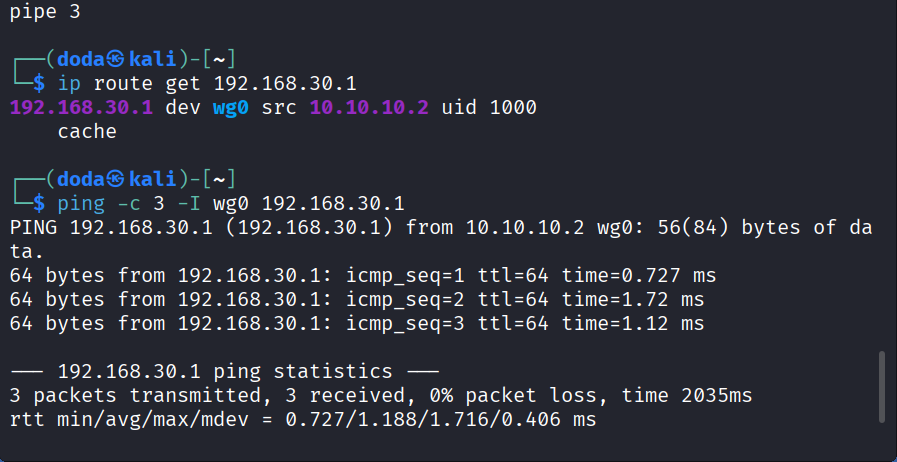
*`ip route get` mostra `dev wg0 src 10.10.10.2`, e o ping forçado pelo túnel sai de `10.10.10.2 wg0` e responde 3/3 (0% de perda). Com o `-I eth0.10` e sem a rota temporária o Kali responde `Destination Host Unreachable` por conta própria: não existe caminho direto a partir dele, o que é diferente do firewall descartando o pacote.*

| Teste | Esperado | Resultado obtido |
|---|---|---|
| Ping direto VLAN 10 → VLAN 30 (`192.168.30.1`), sem túnel, com o Block aplicado | Bloqueado | **Bloqueado**: 100% de perda |
| Ping à VLAN 30 pelo túnel, com o Block ativo | Sucesso | **Sucesso**: 3/3, 0% de perda |
| Caminho do ping pelo túnel | `wg0` | **Sim**: `dev wg0 src 10.10.10.2` |
| Ping forçado pelo túnel (`ping -I wg0`) | Sucesso, origem `10.10.10.2` | **Sucesso**: 3/3, `from 10.10.10.2 wg0` |

O Block não atrapalha o túnel porque o tráfego do WireGuard sai cifrado, em UDP 51820, com destino `This Firewall`, e não casa com a regra da `vlan030`.

### Problemas encontrados e soluções
| Sintoma | Causa | Solução |
|---|---|---|
| `ping -I eth0.10 192.168.30.1`: `Destination Host Unreachable` | A `eth0.10` foi criada com `ipv4.never-default yes`, então não há rota para a VLAN 30 | Para o teste "antes", usei uma rota temporária (`ip route add 192.168.30.0/24 via 192.168.10.1 dev eth0.10`) e removi depois |
| Não achava a aba *General* do WireGuard | Nesta versão a caixa **Enable WireGuard** fica na página **Instances**, abaixo da tabela | Marcar a caixa e clicar **Apply** |
| A regra de firewall não aceitava a porta `51820` | Com protocolo `any` o campo de porta não é usado | Protocolo **UDP** e porta única `51820` |
| `wg show` com `0 B received` e peer vermelho no OPNsense | Chave pública do servidor digitada errada no `[Peer]` do Kali (era outra, não a da instância `wg-admin`) | Copiar a **Public key** da instância e corrigir o `PublicKey` no `wg0.conf`; subir o túnel de novo |
| `ping 10.10.10.1`: `Required key not available` | `AllowedIPs` do Kali tinha só `192.168.30.0/24`; sem o `10.10.10.0/24` o WireGuard não sabia por qual peer enviar | Incluir `10.10.10.0/24` no `AllowedIPs` |
| Ping com 100% de perda logo depois de `wg-quick up` | O primeiro pacote dispara o handshake; o ping terminou antes | Esperar alguns segundos e repetir |
| `ping 192.168.30.1` funciona, `10.10.10.1` não | A regra do grupo cobria só `vlan030 net`; o `10.10.10.1` é do próprio firewall e não faz parte dessa rede | Regra `10.10.10.0/24 → This Firewall` |
| Regra nova criada, mas sem efeito | Faltou o **Apply changes** | Aplicar; o ping passou na hora |
| Regra Block criada, correta e **já aplicada**, mas o ping direto continuava com 0% de perda | Estado de conexão antigo: o firewall é *stateful* e continua liberando o que já tinha estado aberto antes da regra | **Firewall → Diagnostics → States → Reset states**; depois o ping direto deu 100% de perda |
| `wg-quick: 'wg0' is not a WireGuard interface` | O túnel já estava desligado (por exemplo, depois de reiniciar o Kali) | Só aviso; conferir com `sudo wg show` e `ip route get 192.168.30.1` se o caminho é `wg0` ou `eth0.10` |
| `sudo: unable to resolve host kali` | Hostname sem entrada no `/etc/hosts` | Só aviso; ignorado |

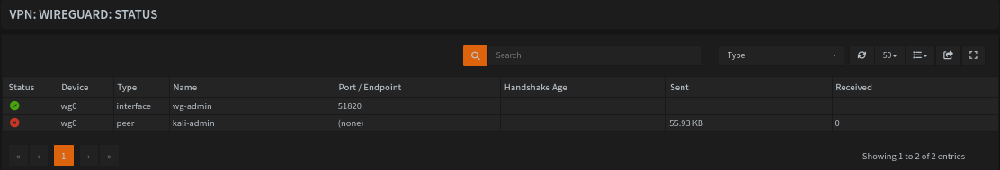
*Com a chave errada: `wg0` verde, mas o peer `kali-admin` vermelho, endpoint `(none)` e `Received 0`.*

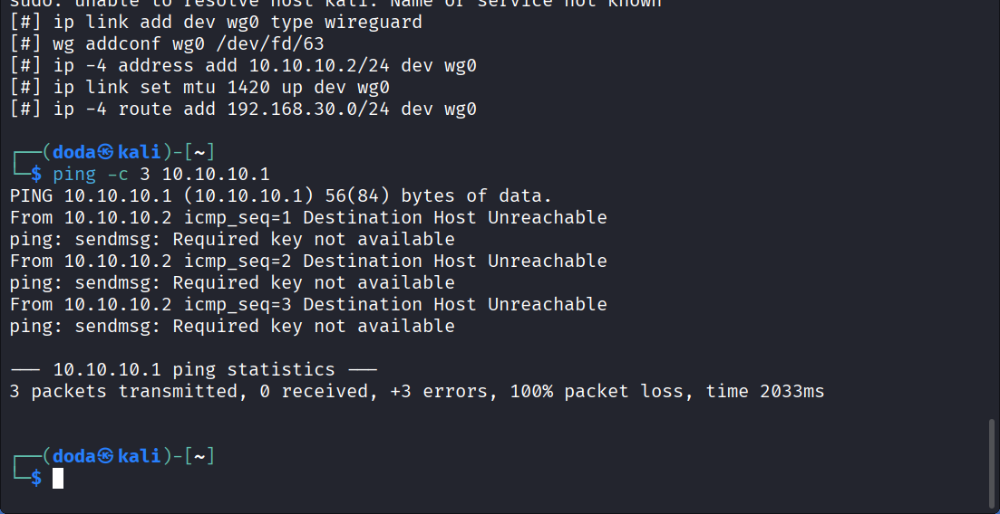
*`Required key not available`: o ping ao `10.10.10.1` não saía porque o `AllowedIPs` não incluía a rede do túnel.*

### Pontos de melhoria
- Ligar o **log** nas regras da ADMIN (Block e Pass) para ver o bloqueio no **Live View** e identificar a regra que decide cada pacote.
- Restringir a regra do túnel a portas específicas (por exemplo SSH e a interface web do Zabbix) em vez de toda a VLAN 30.
- Usar **pre-shared key** no peer e ativar o túnel no boot do Kali (`systemctl enable wg-quick@wg0`).
- Abrir o Zabbix (`http://192.168.30.10`) pelo túnel e monitorar o `wg0` no Zabbix.
- Reservar IP fixo para o Kali no Dnsmasq.

### Próximo passo
Com o acesso direto bloqueado e o acesso pelo túnel validado, o lab está completo. Voltar ao [README](../README.md).

---

## 🇺🇸 English

### Goal
To make the lab more complete, I added a **WireGuard VPN directly on OPNsense**, to show how administrative access to servers would work in a real environment: the admin does not reach the server network through an open inter-VLAN rule; they open an **encrypted, key-authenticated tunnel** to the firewall and only then reach VLAN 30.

### Design
| Item | Value |
|---|---|
| WireGuard server | OPNsense, instance `wg-admin` (`wg0`), `10.10.10.1/24`, UDP `51820` |
| Client | Kali on VLAN 10 (`eth0.10`, `192.168.10.108`), tunnel `10.10.10.2/24` |
| Peer on OPNsense | `kali-admin`, Allowed IPs `10.10.10.2/32`, keepalive 25 s |
| Endpoint used by the client | `192.168.10.1:51820` (OPNsense IP on VLAN 10) |
| Destination reached through the tunnel | VLAN 30 (`192.168.30.0/24`) |

Flow: Kali (VLAN 10) → UDP 51820 → OPNsense → `10.10.10.0/24` tunnel → WireGuard group rule → VLAN 30.

**Direct** access from VLAN 10 to VLAN 30 is blocked by a firewall rule: the tunnel is the only way in.

> **Security:** the **private** keys (Kali's and OPNsense's) never appear in this repository; the screenshots show them as `(hidden)` and the config file uses `<KALI_PRIVATE_KEY>`. **Public** keys are not secret.

### 1. Server on OPNsense
Path: **VPN → WireGuard**.

1. **Instances → +**: name `wg-admin`, port `51820`, tunnel address `10.10.10.1/24`. On save, OPNsense generates the key pair; note the instance **Public key**.
2. **Peers → +**: name `kali-admin`, Kali's **Public key**, **Allowed IPs** `10.10.10.2/32`, instance `wg-admin`, keepalive `25`. Endpoint left empty (Kali initiates).
3. On **Instances**, tick **Enable WireGuard** (below the table; this version has no *General* tab) and click **Apply**.


*Instance `wg-admin` (`wg0`, port 51820, `10.10.10.1/24`, peer `kali-admin`) and **Enable WireGuard** ticked.*


*Peer `kali-admin`: Kali's public key, Allowed IPs `10.10.10.2/32`, instance `wg-admin`, keepalive 25.*

### 2. Firewall rules
| Where | Action | Source | Destination | Purpose |
|---|---|---|---|---|
| **ADMIN** (`vlan010`) | Pass, UDP | `vlan010 net` | `This Firewall`, port `51820` | Let Kali reach the WireGuard server |
| **ADMIN** (`vlan010`) | **Block** | `vlan010 net` | `vlan030 net` | Stop direct access to VLAN 30; must sit **above** the "Admin acessa tudo" rule |
| **WireGuard (Group)** | Pass | `10.10.10.0/24` | `vlan030 net` | What the tunnel may reach |
| **WireGuard (Group)** | Pass | `10.10.10.0/24` | `This Firewall` | Test the tunnel itself (`10.10.10.1`) |

Rules are read top to bottom and the first match wins, so the **Block** sits above "Admin acessa tudo". Traffic **coming out of the tunnel** is filtered on the **WireGuard (Group)** tab. With no rule there, OPNsense blocks everything even after the handshake. **Apply changes** is mandatory after saving (see issues).

### 3. Client on Kali (VLAN 10)
```bash
sudo apt install -y wireguard
umask 077
wg genkey | tee ~/kali.key | wg pubkey > ~/kali.pub   # ~/kali.key is secret
cat ~/kali.pub                                         # this goes in the peer on OPNsense
```
`/etc/wireguard/wg0.conf` (mode `600`):
```ini
[Interface]
Address    = 10.10.10.2/24
PrivateKey = <KALI_PRIVATE_KEY>

[Peer]
PublicKey           = <wg-admin_INSTANCE_PUBLIC_KEY>
Endpoint            = 192.168.10.1:51820
AllowedIPs          = 10.10.10.0/24, 192.168.30.0/24
PersistentKeepalive = 25
```
Bring it up and check:
```bash
sudo wg-quick up wg0
sudo wg show
```
`AllowedIPs` defines **what goes through the tunnel**: the tunnel network itself and VLAN 30. It also creates the route `192.168.30.0/24 dev wg0`.

### 4. Validation

*`sudo wg show` on Kali: peer with endpoint `192.168.10.1:51820` and a `latest handshake` of a few seconds.*


*`ping 192.168.30.1`: 3/3 replies, 0% loss (~0.6 to 0.9 ms). In this print the ping to `10.10.10.1` still failed: the WireGuard group `This Firewall` rule had not been applied yet (see issues).*


*After **Apply changes**: `ping 10.10.10.1` 3/3 (~1.4 to 1.9 ms). `ip route get 192.168.30.1` shows `dev wg0 src 10.10.10.2`: the path to VLAN 30 is the tunnel.*


*VPN → WireGuard → Status: `wg0` and peer `kali-admin` green, endpoint `192.168.10.108`, 3 s handshake, traffic in both directions.*


*Final state on Kali: recent handshake and bytes received and sent (`private key` shows as `(hidden)`).*

| Test | Expected | Actual |
|---|---|---|
| Kali ↔ OPNsense handshake | Green peer and recent `latest handshake` | **Yes**: green in Status, handshake of seconds |
| Ping OPNsense through the tunnel (`10.10.10.1`) | Success | **Success**: 3/3, 0% loss (~1.4 to 1.9 ms) |
| Ping VLAN 30 (`192.168.30.1`) | Success | **Success**: 3/3, 0% loss (~0.6 to 0.9 ms) |
| Path to VLAN 30 | Through `wg0` | **Yes**: `ip route get` → `dev wg0 src 10.10.10.2` |

### 5. VPN only: direct access is blocked
To prove the tunnel is the only path, I blocked VLAN 10 → VLAN 30 and tested both paths. Before the rule existed, a direct ping from VLAN 10 to VLAN 30 worked (3/3, using a temporary route through `eth0.10`), because ADMIN's full-access rule allowed it.


*ADMIN rules, in order: **Block** `vlan010 network → vlan030 network` (description "Admin so acessa servidores pela VPN"), "Admin acessa tudo" and the Pass UDP 51820.*


*Details: action **Block**, interface `vlan010`, direction `In`, protocol `any`, source `vlan010 network`, destination `vlan030 network`, `Quick` ticked.*

Test on Kali, **without the tunnel** and with a temporary route through `eth0.10` to force the direct path:
```bash
sudo wg-quick down wg0
sudo ip route add 192.168.30.0/24 via 192.168.10.1 dev eth0.10
ping -c 3 -I eth0.10 192.168.30.1
```

*First attempt, with the Block rule already created and applied, but with an old connection state in the firewall: the direct ping (source `192.168.10.108`, `eth0.10`) still answers, 3/3. `wg0 is not a WireGuard interface` just means the tunnel was already down.*

After **Reset states** (Firewall → Diagnostics → States):


*Direct ping through VLAN 10: **100% loss**, no `Host Unreachable` (the packet leaves and the firewall drops it).*

Then remove the temporary route and bring the tunnel up:
```bash
sudo ip route del 192.168.30.0/24
sudo wg-quick up wg0
ping -c 3 192.168.30.1
ip route get 192.168.30.1
sudo wg show
```

*With the Block active, the ping through the tunnel answers 3/3 (0% loss, ~0.4 to 1.7 ms) and `ip route get` shows `dev wg0 src 10.10.10.2`.*


*`sudo wg show`: recent handshake and traffic in both directions.*

**How to tell which path a packet takes.** `ping` only shows the destination and the reply; the routing table picks the path. Two commands make it explicit:
```bash
ip route get 192.168.30.1          # dev wg0 = tunnel; dev eth0.10 = direct through VLAN 10
ping -c 3 -I wg0 192.168.30.1      # forces the ping through the tunnel
```

*`ip route get` shows `dev wg0 src 10.10.10.2`, and the ping forced through the tunnel leaves from `10.10.10.2 wg0` and answers 3/3 (0% loss). With `-I eth0.10` and no temporary route, Kali itself answers `Destination Host Unreachable`: it has no direct path, which is different from the firewall dropping the packet.*

| Test | Expected | Actual |
|---|---|---|
| Direct ping VLAN 10 → VLAN 30 (`192.168.30.1`), no tunnel, Block applied | Blocked | **Blocked**: 100% loss |
| Ping to VLAN 30 through the tunnel, Block active | Success | **Success**: 3/3, 0% loss |
| Path of the tunnel ping | `wg0` | **Yes**: `dev wg0 src 10.10.10.2` |
| Ping forced through the tunnel (`ping -I wg0`) | Success, source `10.10.10.2` | **Success**: 3/3, `from 10.10.10.2 wg0` |

The Block does not affect the tunnel because WireGuard traffic leaves encrypted, over UDP 51820, to `This Firewall`, and does not match the `vlan030` rule.

### Issues found and fixes
| Symptom | Cause | Fix |
|---|---|---|
| `ping -I eth0.10 192.168.30.1`: `Destination Host Unreachable` | `eth0.10` was created with `ipv4.never-default yes`, so there is no route to VLAN 30 | For the "before" test I used a temporary route (`ip route add 192.168.30.0/24 via 192.168.10.1 dev eth0.10`) and removed it afterwards |
| WireGuard *General* tab not found | In this version **Enable WireGuard** sits on the **Instances** page, below the table | Tick it and click **Apply** |
| Firewall rule would not accept port `51820` | With protocol `any` the port field is not used | Protocol **UDP** and single port `51820` |
| `wg show` with `0 B received` and red peer on OPNsense | Wrong server public key in Kali's `[Peer]` (not the `wg-admin` instance key) | Copy the instance **Public key** and fix `PublicKey` in `wg0.conf`; bring the tunnel up again |
| `ping 10.10.10.1`: `Required key not available` | Kali's `AllowedIPs` had only `192.168.30.0/24`; without `10.10.10.0/24` WireGuard had no peer to send to | Add `10.10.10.0/24` to `AllowedIPs` |
| 100% loss right after `wg-quick up` | The first packet triggers the handshake; the ping ended before it finished | Wait a few seconds and repeat |
| `ping 192.168.30.1` works, `10.10.10.1` does not | The group rule covered only `vlan030 net`; `10.10.10.1` is the firewall itself, not part of that network | Rule `10.10.10.0/24 → This Firewall` |
| New rule created but no effect | **Apply changes** was missing | Apply; the ping worked right away |
| Block rule created, correct and **already applied**, but the direct ping still showed 0% loss | Old connection state: the firewall is *stateful* and keeps allowing what already had a state open before the rule | **Firewall → Diagnostics → States → Reset states**; the direct ping then showed 100% loss |
| `wg-quick: 'wg0' is not a WireGuard interface` | The tunnel was already down (for example, after rebooting Kali) | Only a warning; check with `sudo wg show` and `ip route get 192.168.30.1` whether the path is `wg0` or `eth0.10` |
| `sudo: unable to resolve host kali` | Hostname has no `/etc/hosts` entry | Only a warning; ignored |


*With the wrong key: `wg0` green, but peer `kali-admin` red, endpoint `(none)` and `Received 0`.*


*`Required key not available`: the ping to `10.10.10.1` never left because `AllowedIPs` did not include the tunnel network.*

### Improvements
- Turn on **logging** for the ADMIN rules (Block and Pass) to see the block in **Live View** and identify which rule decides each packet.
- Restrict the tunnel rule to specific ports (for example SSH and the Zabbix web interface) instead of all of VLAN 30.
- Use a **pre-shared key** on the peer and enable the tunnel at Kali's boot (`systemctl enable wg-quick@wg0`).
- Open Zabbix (`http://192.168.30.10`) through the tunnel and monitor `wg0` in Zabbix.
- Reserve a fixed IP for Kali in Dnsmasq.

### Next step
With direct access blocked and tunnel access validated, the lab is complete. Back to the [README](../README.md).
